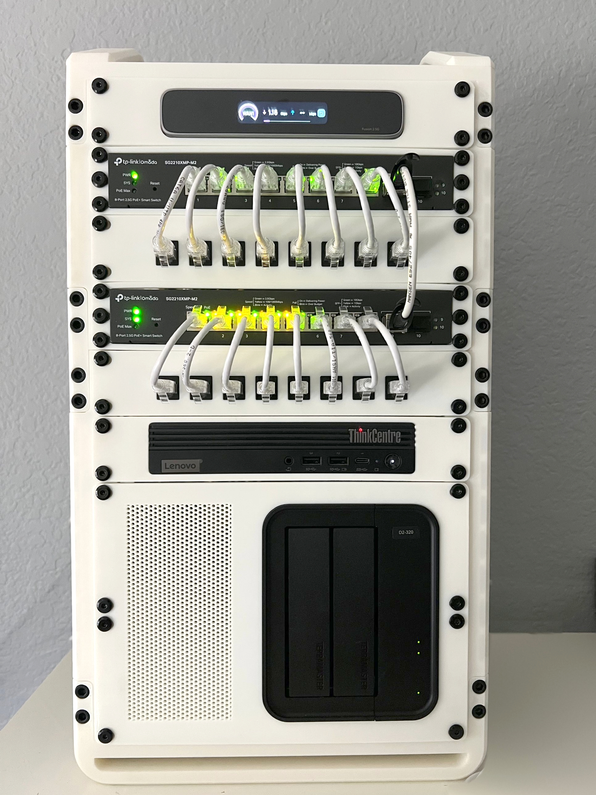

# Homelab

  

Self-hosted infrastructure running 24/7 in a 3D-printed 10" mini rack. Built to replace cloud camera subscriptions with local NVR and home automation, and to practice Linux server administration on real hardware.

---

## Hardware

| Rack position | Device | Role |
|---------------|--------|------|
| 1 | TP-Link Omada Fusion 2.5G | Gateway / router / Omada controller |
| 2 | TP-Link Omada SG2210XMP-M2 | 8-port 2.5G PoE+ switch (Switch 1) |
| 3 | Patch panel | |
| 4 | TP-Link Omada SG2210XMP-M2 | 8-port 2.5G PoE+ switch (Switch 2), powers IP cameras |
| 5 | Patch panel | |
| 6 | Lenovo ThinkCentre M70q Gen 4 | Debian server: i7-13700T, 32 GB RAM, 1 TB Samsung 990 Pro NVMe, 2.5G NIC |
| 7 | TerraMaster D2-320 | 2-bay DAS: 10 TB (NVR recordings) + 8 TB (data) |

---

## Services

All services run as Docker containers on Debian, managed through Portainer.

| Service | Purpose |
|---------|---------|
| Frigate | NVR with object detection for 5 PoE IP cameras, GPU-accelerated via Intel UHD 770 / OpenVINO |
| Home Assistant | Home automation and camera event notifications |
| Mosquitto | MQTT broker linking Frigate and Home Assistant |
| ntfy | Self-hosted push notifications |
| Immich | Self-hosted photo library |
| AdGuard Home | Network-wide DNS filtering |
| Uptime Kuma | Service uptime monitoring |
| Netdata | Real-time host, GPU, container, and disk monitoring |
| Portainer | Docker container management |

Remote access is through Tailscale, with no ports exposed to the internet.

---

## Storage Layout

| Disk | Mount | Purpose |
|------|-------|---------|
| 1 TB NVMe | `/` | Debian OS and Docker |
| 10 TB HDD | `/srv/frigate` | NVR recordings |
| 8 TB HDD | `/srv/immich` | Photo library data |

Data disks are mounted by UUID in `/etc/fstab` so device names can change without breaking mounts.

---

## Operations

| Practice | How |
|----------|-----|
| Boot ordering | Frigate is started by a systemd unit that waits for the recording disk to mount and the gateway to respond before launching (the Fusion gateway takes ~3 minutes to come up after a power loss) |
| Backups | Nightly Immich database backups |
| Weekly health check | SMART drive health, CPU temps and load, memory and swap, disk usage, Docker container status, failed systemd units, kernel storage errors |
| Secrets | Credentials rotated immediately if ever exposed in logs or terminal output |

---

## Issues & Fixes

| # | Symptom | Root cause | Fix |
|---|---------|-----------|-----|
| 1 | NVMe system disk nearly full | UUID typo in `/etc/fstab` meant the 10 TB disk never mounted, so Frigate wrote recordings to the system disk | Verified the disk UUID, corrected `/etc/fstab`, and added a systemd dependency so Frigate won't start unless the recording disk is mounted |
| 2 | Frigate failed to start after power outages | Container launched before the gateway and storage were ready | Moved startup from Docker's restart policy to a systemd unit with mount and network checks |
| 3 | Netdata showed the wrong size for Frigate storage | Dashboard combined multiple mounts into one view | Reconfigured the view to report only the dedicated recording disk |

---

## Roadmap

- [ ] VLAN segmentation for wireless and IoT devices
- [ ] Replace the DAS with a 3D-printed hot-swap drive bay
- [ ] UPS backup power
- [ ] Off-server backup target for Immich data

---

## Skills Demonstrated

- Debian Linux server administration
- Docker container deployment and management
- systemd service ordering and dependencies
- Disk management, `/etc/fstab`, and UUID-based mounts
- VLAN-capable managed switching and PoE planning
- Monitoring, alerting, and routine health checks
- Secure remote access without port forwarding
