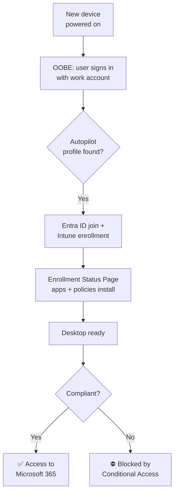

# Lab 01 – Zero-Touch Windows Deployment with Autopilot, Intune & Conditional Access

  

## Business Scenario

A company is hiring remote employees and wants laptops shipped straight from the vendor to the new hire's home. IT should never have to image, touch, or hand-configure the device. When the employee powers it on and signs in with their work account, the device must:

1. Join Microsoft Entra ID and enroll in Intune automatically
2. Receive company apps and security settings before the user reaches the desktop
3. Encrypt the drive and back up the recovery key
4. Rotate the local admin password automatically
5. Be **blocked from company data** if it ever falls out of compliance

This lab builds that end-to-end using Hyper-V virtual machines as the "shipped laptops."

---

## Architecture



| Component | Purpose in this lab |
|-----------|--------------------|
| Hyper-V | Hosts two Windows 11 VMs that stand in for brand-new laptops |
| Windows Autopilot | Recognizes the device by hardware hash and applies the deployment profile at OOBE |
| Microsoft Entra ID | Device identity (Entra join), users, groups, Conditional Access |
| Microsoft Intune | Enrollment, configuration, compliance, app deployment |
| Enrollment Status Page (ESP) | Holds the user at setup until required apps and policies are applied |
| BitLocker | Full-disk encryption with recovery key escrowed to Entra ID |
| Windows LAPS | Unique, rotating local admin password stored in Entra ID |
| Conditional Access | Requires a compliant device to access Microsoft 365 |

---

## Environment

| Item | Details |
|------|---------|
| Tenant | Microsoft 365 Business Premium trial (includes Intune + Entra ID P1) |
| Hypervisor | Hyper-V on a Windows 11 host (16 GB RAM) |
| Devices | `W11-LAB-01` (built in Hyper-V Manager GUI), `W11-LAB-02` (built with PowerShell) |
| VM spec | Generation 2, 2 vCPU, 4 GB static RAM, 64 GB VHDX, Default Switch |
| VM security | Secure Boot (Microsoft Windows template) + virtual TPM |
| OS | Windows 11 Enterprise Evaluation |
| Test users | `lab.user1`, `lab.user2` (licensed), `breakglass-admin` (excluded from CA) |
| Admin tools | Intune admin center, Entra admin center, Hyper-V Manager, PowerShell 5.1 |

---

## Build Steps

### Phase 0 – Build the Lab VMs in Hyper-V ✅

Two identical VMs were built two different ways: once in the GUI to learn every setting, and once in PowerShell to make the build repeatable.

**W11-LAB-01 – Hyper-V Manager GUI**

| Wizard / Settings page | Value |
|------------------------|-------|
| Generation | Generation 2 (UEFI, required for Windows 11) |
| Memory | 4096 MB, Dynamic Memory **off** |
| Networking | Default Switch |
| Virtual hard disk | 64 GB VHDX under `C:\Hyper-V` |
| Installation media | `C:\ISO\Win11-Ent-Eval.iso` |
| Security | Secure Boot on (Microsoft Windows template), **Enable Trusted Platform Module** checked |
| Processor | 2 virtual processors |
| Checkpoints | Automatic checkpoints **off** |
| Automatic Start Action | Nothing |


*Wizard summary: Generation 2, 4096 MB, Default Switch, VHDX under `C:\Hyper-V`. Dynamic Memory was turned off after creation.*


*Security: Secure Boot (Microsoft Windows template) and Trusted Platform Module enabled*


*Checkpoints: standard checkpoints, automatic checkpoints off*


*ISO moved out of Downloads to `C:\ISO\Win11-Ent-Eval.iso` and the DVD drive repointed to it*

**W11-LAB-02 – PowerShell**

```powershell
$VM  = "W11-LAB-02"
$ISO = "C:\ISO\Win11-Ent-Eval.iso"

New-VM -Name $VM -Generation 2 -MemoryStartupBytes 4GB `
       -NewVHDPath "C:\Hyper-V\$VM\$VM.vhdx" -NewVHDSizeBytes 64GB `
       -Path "C:\Hyper-V" -SwitchName "Default Switch"

Set-VM -Name $VM -ProcessorCount 2 -StaticMemory `
       -AutomaticCheckpointsEnabled $false -AutomaticStartAction Nothing

Set-VMFirmware -VMName $VM -EnableSecureBoot On -SecureBootTemplate "MicrosoftWindows"
Set-VMKeyProtector -VMName $VM -NewLocalKeyProtector
Enable-VMTPM -VMName $VM

Add-VMDvdDrive -VMName $VM -Path $ISO
```

**Verify both VMs match**

```powershell
Get-VM W11-LAB-0* | Select-Object Name, Generation, ProcessorCount,
    @{n='MemoryGB';e={$_.MemoryStartup/1GB}}, AutomaticCheckpointsEnabled, AutomaticStartAction
```

**Install Windows and freeze at OOBE**

1. Booted each VM from the ISO and installed Windows 11 Enterprise Evaluation (passed the Windows 11 TPM/Secure Boot requirements check)
2. Stopped at the **OOBE region screen** and shut down without completing setup
3. Set the virtual hard disk as the first boot device
4. Took a checkpoint named `Clean-OOBE` on each VM

```powershell
Checkpoint-VM -Name W11-LAB-01, W11-LAB-02 -SnapshotName "Clean-OOBE"
Get-VMSnapshot -VMName W11-LAB-0*
```

> `Clean-OOBE` is the virtual equivalent of a new laptop out of the box. Any test can be rolled back to a factory-fresh state in seconds instead of reinstalling Windows.


*Both VMs match (Gen 2, 2 vCPU, 4 GB static, automatic checkpoints off), and both have a `Clean-OOBE` checkpoint*

### Phase 1 – Tenant Preparation

| Step | Where | Configuration |
|------|-------|---------------|
| 1.1 | Entra admin center → Users | Create test users and assign Business Premium licenses |
| 1.2 | Entra → Users | Create a **break-glass** Global Admin account, excluded from all CA policies |
| 1.3 | Entra → Properties → Security defaults | **Disable** security defaults (required before Conditional Access can be used) |
| 1.4 | Intune → Devices → Enrollment → Windows → Automatic Enrollment | Set **MDM user scope** to *All* (or a pilot group) |
| 1.5 | Entra → Devices → Device settings | Confirm users may join devices to Entra ID, and enable **Microsoft Entra Local Administrator Password Solution (LAPS)** |
| 1.6 | Intune → Tenant administration → Customization | Add company name, logo, and support contact (shown during OOBE) |

📸 *Screenshot: Automatic Enrollment MDM user scope*

### Phase 2 – Dynamic Device Group

Create a group that automatically contains every Autopilot-registered device.

- **Entra → Groups → New group**
- Type: Security · Membership: **Dynamic Device**
- Name: `SG-Autopilot-Devices`
- Rule:

```text
(device.devicePhysicalIDs -any (_ -contains "[ZTDId]"))
```

> `ZTDId` is the tag Autopilot stamps on every registered device. Any device imported into Autopilot joins this group automatically, so all profiles and policies target it without manual assignment.

📸 *Screenshot: dynamic membership rule*

### Phase 3 – Capture the Hardware Hash and Register in Autopilot

#### 3a – Capture the hash at OOBE (offline CSV) ✅

In production, the OEM or reseller registers devices. Here the hash was captured manually, which is the same method IT uses for existing devices or vendors that don't support Autopilot registration.

In each VM at the OOBE region screen, press **Shift + F10** to open a command prompt, then:

```powershell
powershell
Set-ExecutionPolicy -Scope Process -ExecutionPolicy Bypass -Force
New-Item -Type Directory -Path C:\HWID
Install-Script -Name Get-WindowsAutopilotInfo -Force
Get-WindowsAutopilotInfo -OutputFile C:\HWID\W11-LAB-02.csv
Get-ChildItem C:\HWID
```

#### 3b – Get the CSV out of the VM ✅

At OOBE there's no signed-in user, so there's no clipboard or file copy into the host. Instead, the VM was shut down and its disk was mounted **read-only** on the host:

```powershell
# On the Hyper-V host
Mount-VHD -Path "C:\Hyper-V\W11-LAB-02\W11-LAB-02.vhdx" -ReadOnly
Get-Volume                         # Windows partition mounted as D:
New-Item -Type Directory -Path C:\HWID -Force
Copy-Item D:\HWID\*.csv C:\HWID\
Dismount-VHD -Path "C:\Hyper-V\W11-LAB-02\W11-LAB-02.vhdx"
```

The same steps were repeated for `W11-LAB-01`. Both VMs were then rolled back to `Clean-OOBE`, which discards the capture changes and returns them to an untouched state for the Autopilot test.

| File | Size |
|------|------|
| `W11-LAB-01.csv` | 8,184 bytes |
| `W11-LAB-02.csv` | 8,184 bytes |

> Hardware hash CSVs are excluded from the repo by `.gitignore`, and serial numbers are blurred in all screenshots. Both uniquely identify a device.


*W11-LAB-01: hash captured to CSV and verified (serial redacted)*


*W11-LAB-02: the `Get-WindowAutopilotInfo` typo from [Issue #4](#issues--fixes), then the corrected command (serial redacted)*

#### 3c – Import into Autopilot

**Intune → Devices → Enrollment → Windows → Devices (Autopilot) → Import** → select the CSV. The devices should appear within ~15 minutes and join `SG-Autopilot-Devices` automatically.

> **Alternative:** `Get-WindowsAutopilotInfo -Online -GroupTag "LAB"` uploads the hash directly after an Intune admin sign-in, so no CSV is created.

> **Note:** Windows Autopilot *device preparation* is a newer option that skips hardware hash registration. This lab uses classic user-driven Autopilot because it remains heavily tested on MD-102 and is still the standard in most enterprises.

📸 *Screenshot: devices listed in Autopilot devices (serials blurred)*

### Phase 4 – Autopilot Deployment Profile

**Intune → Devices → Enrollment → Windows → Deployment profiles → Create profile (Windows PC)**

| Setting | Value | Why |
|---------|-------|-----|
| Convert all targeted devices to Autopilot | No | Not needed for new devices |
| Deployment mode | User-driven | User signs in with their own account |
| Join to Entra ID as | Microsoft Entra joined | Cloud-only, no on-prem AD dependency |
| Microsoft Software License Terms | Hide | Fewer clicks for the user |
| Privacy settings | Hide | Defaults applied by policy |
| Hide change account options | Hide | Prevents personal-account setup |
| User account type | **Standard** | User does not get local admin |
| Apply device name template | Yes → `LAB-%SERIAL%` | Consistent naming (15-character max) |
| Assignment | `SG-Autopilot-Devices` | |

📸 *Screenshot: profile summary and "Assigned" profile status on the device*

### Phase 5 – Enrollment Status Page

**Intune → Devices → Enrollment → Windows → Enrollment Status Page → Create**

| Setting | Value |
|---------|-------|
| Show app and profile configuration progress | Yes |
| Show error when installation takes longer than | 60 minutes |
| Block device use until all apps and profiles are installed | Yes → selected apps only |
| Required apps | Microsoft 365 Apps, 7-Zip (Win32) |
| Assignment | `SG-Autopilot-Devices` |

### Phase 6 – Security Configuration

**BitLocker:** Endpoint security → Disk encryption → Create policy → Windows → BitLocker

| Setting | Value |
|---------|-------|
| Require device encryption | Enabled |
| Allow warning for other disk encryption | Disabled (enables silent encryption) |
| Allow standard user encryption | Enabled |
| OS drive recovery: save recovery info to Entra ID | Enabled, and require backup before encryption |

**Windows LAPS:** Endpoint security → Account protection → Create policy → Local admin password solution

| Setting | Value |
|---------|-------|
| Backup directory | Backup to Microsoft Entra ID only |
| Password age (days) | 30 |
| Password complexity | Large + small letters + numbers + special characters |
| Post-authentication actions | Reset password and log off |

📸 *Screenshot: both policies assigned to `SG-Autopilot-Devices`*

### Phase 7 – Applications

**Microsoft 365 Apps:** Apps → Windows → Add → Microsoft 365 Apps (Windows 10 and later). Required assignment.

**7-Zip as a Win32 app** (demonstrates custom packaging):

```powershell
# Package the MSI with the Microsoft Win32 Content Prep Tool
.\IntuneWinAppUtil.exe -c .\source -s 7z-x64.msi -o .\output
```

| Field | Value |
|-------|-------|
| Install command | `msiexec /i "7z-x64.msi" /qn` |
| Uninstall command | `msiexec /x {ProductCode} /qn` |
| Install behavior | System |
| Detection rule | MSI product code (auto-detected) |
| Assignment | Required → `SG-Autopilot-Devices` |

> `.intunewin` output files are excluded from the repo by `.gitignore`.

### Phase 8 – Compliance Policy

**Devices → Compliance → Create policy → Windows 10 and later**

| Category | Setting | Value |
|----------|---------|-------|
| Device Health | Require BitLocker | Require |
| Device Health | Require Secure Boot | Require |
| Device Properties | Minimum OS version | Current supported build |
| System Security | Firewall | Require |
| System Security | Microsoft Defender Antimalware | Require |
| System Security | Real-time protection | Require |
| Actions | Mark device noncompliant | Immediately (0 days) |

Assign to `SG-Autopilot-Devices`.

### Phase 9 – Conditional Access

**Entra → Protection → Conditional Access → New policy**

| Setting | Value |
|---------|-------|
| Name | `CA01 - Require compliant device for M365` |
| Users | Include: test users group · **Exclude: break-glass account** |
| Target resources | Office 365 |
| Conditions → Device platforms | Windows |
| Grant | **Require device to be marked as compliant** |
| Enable policy | **Report-only** first, then **On** after verification |

> Starting in Report-only confirms the impact in sign-in logs before enforcing, the same change-management approach used in production.

📸 *Screenshot: CA policy summary*

---

## Deployment & Verification

1. In Hyper-V, apply the `Clean-OOBE` checkpoint to the VM so it boots like a brand-new device
2. Start the VM, connect to the network, and sign in as `lab.user1`
3. Watch the company branding and ESP progress screens

| Check | How | Expected result |
|-------|-----|-----------------|
| Entra join | `dsregcmd /status` | `AzureAdJoined : YES` |
| Intune enrollment | Intune → Devices → Windows | Device listed as `LAB-<serial>`, user `lab.user1` |
| Device name | Settings → System → About | Matches template |
| Standard user | `net localgroup administrators` | `lab.user1` **not** listed |
| Apps | Start menu | Microsoft 365 Apps + 7-Zip installed |
| BitLocker | `manage-bde -status C:` | Protection On, XTS-AES |
| Recovery key escrow | Intune → device → Recovery keys | Key present |
| LAPS | Intune → device → Local admin password | Password retrievable, rotation date shown |
| Compliance | Intune → device → Device compliance | **Compliant** |
| CA (Report-only) | Entra → Sign-in logs → Report-only tab | "Report-only: Success" |

A verification script that checks most of these from the device is in [`../../practice/Test-DeviceReadiness.ps1`](../../practice/Test-DeviceReadiness.ps1).

### Proving Conditional Access Works

1. Switch the CA policy from Report-only to **On**
2. Temporarily edit the compliance policy so the **minimum OS version** is higher than the device's build
3. Sync the device (Settings → Accounts → Access work or school → Info → Sync)
4. Device shows **Not compliant**, and opening Outlook or office.com is **blocked** with a "device must be compliant" message
5. Revert the minimum OS version, sync again, and access is restored

📸 *Screenshots: noncompliant status, CA block page, sign-in log showing "Failure" with policy CA01*

---

## Issues & Fixes

| # | Symptom | Root cause | Fix |
|---|---------|-----------|-----|
| 1 | VM showed UEFI boot summary: "The boot loader failed" | Missed the *"Press any key to boot from CD or DVD"* prompt, so the VM skipped the ISO and tried to boot from an empty disk | Restarted the VM and pressed a key at the prompt |
| 2 | Hash-capture commands ran but weren't in the VM | Typed the first commands into a PowerShell window on the **host**, not the VM console | Re-ran them inside the VM's Shift+F10 prompt. Lesson: always confirm which machine a console belongs to before running commands |
| 3 | Prompted to install the NuGet provider and trust PSGallery | Fresh Windows install has no NuGet provider, and `Install-Script` needs it to download from the PowerShell Gallery | Answered **Y** to both prompts (`-Force` suppresses them on reruns) |
| 4 | `No match was found for the specified search criteria` | Typo: `Get-WindowAutopilotInfo` (missing the "s") | Corrected to `Get-WindowsAutopilotInfo` |
| 5 | No way to copy the CSV from the VM to the host | At OOBE there's no signed-in user, so Hyper-V enhanced session (clipboard/file copy) isn't available | Shut down the VM, mounted its VHDX **read-only** on the host with `Mount-VHD`, copied the CSV, then dismounted |
| 6 | `'Test-Path' is not recognized` when verifying the rollback | Shift+F10 opens **cmd**, and `Test-Path` is a PowerShell cmdlet | Ran `dir C:\HWID` in cmd (*File Not Found* = rollback confirmed), or typed `powershell` first |
| 7 | `Get-VM : You do not have the required permission to complete this task` | PowerShell on the host wasn't elevated (prompt opened in `C:\Users\<user>`, not `C:\WINDOWS\system32`) | Reopened PowerShell with **Run as administrator**. Hyper-V cmdlets need admin rights or membership in the Hyper-V Administrators group |

<details>
<summary>Common issues reference</summary>

| Symptom | Likely cause |
|---------|-------------|
| Device doesn't get Autopilot profile at OOBE | Profile not yet assigned (check "Profile status" on the Autopilot device); dynamic group membership still processing |
| "Something went wrong" / 80180018 during enrollment | User not licensed for Intune, or MDM user scope doesn't include the user |
| ESP stuck on apps | Win32 detection rule wrong, so Intune keeps thinking install failed |
| BitLocker not encrypting silently | "Allow warning for other disk encryption" not disabled, or no TPM |
| CA policy can't be created | Security defaults still enabled |
| Device noncompliant right after enrollment | Compliance not yet evaluated; sync and wait before testing |

</details>

---

## Cleanup

- Delete the device from **Intune → Devices**, then from **Autopilot devices** (Intune record must go first)
- Delete the Entra device object
- Set CA policy to **Off** or delete it
- Remove test users or let the trial expire
- Apply `Clean-OOBE` to the VMs, or delete them

---

## Skills Demonstrated

- Hyper-V VM provisioning via GUI and PowerShell, with checkpoints for repeatable testing
- Windows Autopilot hardware hash capture (offline CSV) and user-driven deployment
- Intune enrollment, dynamic groups, and policy targeting
- Win32 app packaging and detection rules
- Endpoint security: BitLocker, Windows LAPS, compliance policies
- Conditional Access design with break-glass exclusion and report-only rollout
- Verification and troubleshooting with `dsregcmd`, `manage-bde`, and Intune diagnostics
