# Lab 01 – Zero-Touch Windows Deployment with Autopilot, Intune & Conditional Access

  

## Business Scenario

A company is hiring remote employees and wants laptops shipped straight from the vendor to the new hire's home. IT should never have to image, touch, or hand-configure the device. When the employee powers it on and signs in with their work account, the device must:

1. Join Microsoft Entra ID and enroll in Intune automatically
2. Receive company apps and security settings before the user reaches the desktop
3. Encrypt the drive and back up the recovery key
4. Rotate the local admin password automatically
5. Be **blocked from company data** if it ever falls out of compliance

This lab builds that end-to-end using Hyper-V virtual machines as the "shipped laptops."

---

## Architecture

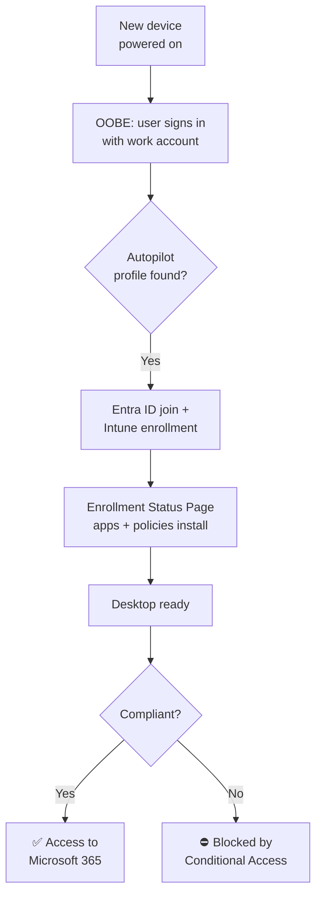

| Component | Purpose in this lab |
|-----------|--------------------|
| Hyper-V | Hosts two Windows 11 VMs that stand in for brand-new laptops |
| Windows Autopilot | Recognizes the device by hardware hash and applies the deployment profile at OOBE |
| Microsoft Entra ID | Device identity (Entra join), users, groups, Conditional Access |
| Microsoft Intune | Enrollment, configuration, compliance, app deployment |
| Enrollment Status Page (ESP) | Holds the user at setup until required apps and policies are applied |
| BitLocker | Full-disk encryption with recovery key escrowed to Entra ID |
| Windows LAPS | Unique, rotating local admin password stored in Entra ID |
| Conditional Access | Requires a compliant device to access Microsoft 365 |

---

## Environment

| Item | Details |
|------|---------|
| Tenant | Microsoft 365 Business Premium trial (includes Intune + Entra ID P1) |
| Hypervisor | Hyper-V on a Windows 11 host (16 GB RAM) |
| Devices | `W11-LAB-01` (built in Hyper-V Manager GUI), `W11-LAB-02` (built with PowerShell) |
| VM spec | Generation 2, 2 vCPU, 4 GB static RAM, 64 GB VHDX, Default Switch |
| VM security | Secure Boot (Microsoft Windows template) + virtual TPM |
| OS | Windows 11 Enterprise Evaluation |
| Test users | `lab.user1`, `lab.user2` (licensed), `breakglass-admin` (excluded from CA) |
| Admin tools | Intune admin center, Entra admin center, Hyper-V Manager, PowerShell 5.1 |

---

## Build Steps

### Phase 0 – Build the Lab VMs in Hyper-V ✅

Two identical VMs were built two different ways: once in the GUI to learn every setting, and once in PowerShell to make the build repeatable.

**W11-LAB-01 – Hyper-V Manager GUI**

| Wizard / Settings page | Value |
|------------------------|-------|
| Generation | Generation 2 (UEFI, required for Windows 11) |
| Memory | 4096 MB, Dynamic Memory **off** |
| Networking | Default Switch |
| Virtual hard disk | 64 GB VHDX under `C:\Hyper-V` |
| Installation media | `C:\ISO\Win11-Ent-Eval.iso` |
| Security | Secure Boot on (Microsoft Windows template), **Enable Trusted Platform Module** checked |
| Processor | 2 virtual processors |
| Checkpoints | Automatic checkpoints **off** |
| Automatic Start Action | Nothing |

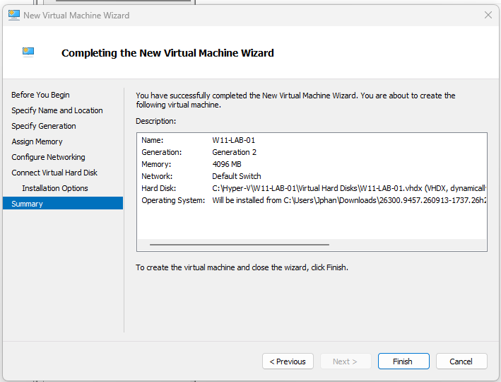
*Wizard summary: Generation 2, 4096 MB, Default Switch, VHDX under `C:\Hyper-V`. Dynamic Memory was turned off after creation.*

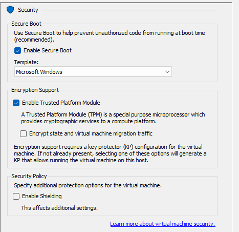
*Security: Secure Boot (Microsoft Windows template) and Trusted Platform Module enabled*

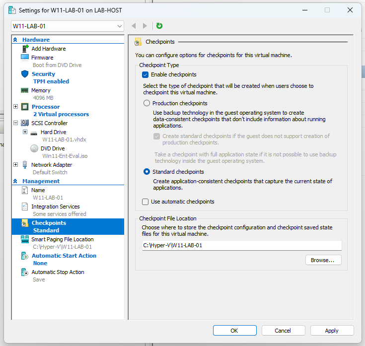
*Checkpoints: standard checkpoints, automatic checkpoints off*

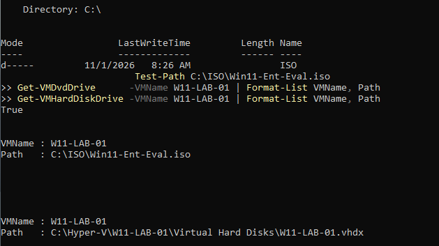
*ISO moved out of Downloads to `C:\ISO\Win11-Ent-Eval.iso` and the DVD drive repointed to it*

**W11-LAB-02 – PowerShell**

```powershell
$VM  = "W11-LAB-02"
$ISO = "C:\ISO\Win11-Ent-Eval.iso"

New-VM -Name $VM -Generation 2 -MemoryStartupBytes 4GB `
       -NewVHDPath "C:\Hyper-V\$VM\$VM.vhdx" -NewVHDSizeBytes 64GB `
       -Path "C:\Hyper-V" -SwitchName "Default Switch"

Set-VM -Name $VM -ProcessorCount 2 -StaticMemory `
       -AutomaticCheckpointsEnabled $false -AutomaticStartAction Nothing

Set-VMFirmware -VMName $VM -EnableSecureBoot On -SecureBootTemplate "MicrosoftWindows"
Set-VMKeyProtector -VMName $VM -NewLocalKeyProtector
Enable-VMTPM -VMName $VM

Add-VMDvdDrive -VMName $VM -Path $ISO
```

**Verify both VMs match**

```powershell
Get-VM W11-LAB-0* | Select-Object Name, Generation, ProcessorCount,
    @{n='MemoryGB';e={$_.MemoryStartup/1GB}}, AutomaticCheckpointsEnabled, AutomaticStartAction
```

**Install Windows and freeze at OOBE**

1. Booted each VM from the ISO and installed Windows 11 Enterprise Evaluation (passed the Windows 11 TPM/Secure Boot requirements check)
2. Stopped at the **OOBE region screen** and shut down without completing setup
3. Set the virtual hard disk as the first boot device
4. Took a checkpoint named `Clean-OOBE` on each VM

```powershell
Checkpoint-VM -Name W11-LAB-01, W11-LAB-02 -SnapshotName "Clean-OOBE"
Get-VMSnapshot -VMName W11-LAB-0*
```

> `Clean-OOBE` is the virtual equivalent of a new laptop out of the box. Any test can be rolled back to a factory-fresh state in seconds instead of reinstalling Windows.

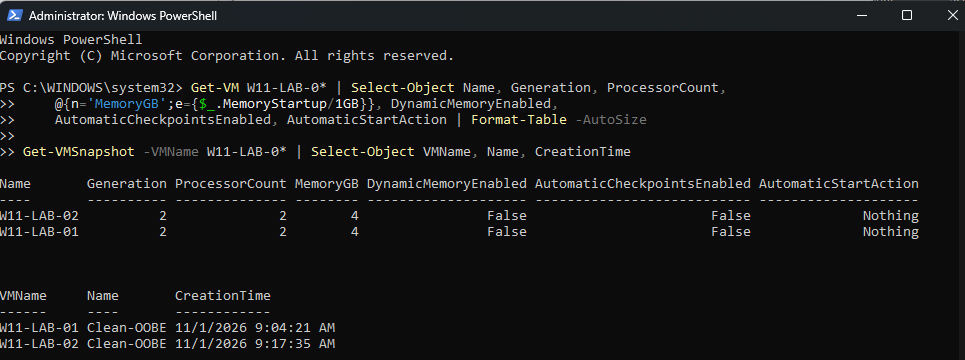
*Both VMs match (Gen 2, 2 vCPU, 4 GB static, automatic checkpoints off), and both have a `Clean-OOBE` checkpoint*

### Phase 1 – Tenant Preparation ✅

A Microsoft 365 Business Premium trial was created as a dedicated lab tenant (1-month term, 5 seats, recurring billing set to **cancel on expiration** immediately after signup).

| Step | Where | Configuration |
|------|-------|---------------|
| 1.1 | Entra admin center → Users | Create test users and assign Business Premium licenses |
| 1.2 | Entra → Users | Create a **break-glass** Global Admin account, excluded from all CA policies |
| 1.3 | Entra → Properties → Security defaults | **Disable** security defaults (required before Conditional Access can be used) |
| 1.4 | Intune → Devices → Enrollment → Windows → Automatic Enrollment | Set **MDM user scope** to *All* (or a pilot group) |
| 1.5 | Entra → Devices → Device settings | Confirm users may join devices to Entra ID, and enable **Microsoft Entra Local Administrator Password Solution (LAPS)** |
| 1.6 | Intune → Tenant administration → Customization | Add company name and support contact (shown in Company Portal and during enrollment) |

#### 1.1 – Test users and licenses

| Account | License | Role | Notes |
|---------|---------|------|-------|
| `lab.user1` | Business Premium | – | Autopilot test user |
| `lab.user2` | Business Premium | – | Second test user |
| `breakglass-admin` | **None** | Global Administrator | Emergency access only |

Each account had **Usage location = United States** set on creation. A license can't be assigned to a user without a usage location.

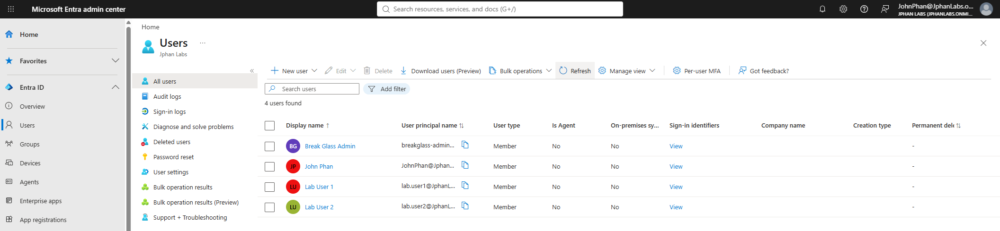
*Entra ID → All users: the admin account, two test users, and the break-glass account*

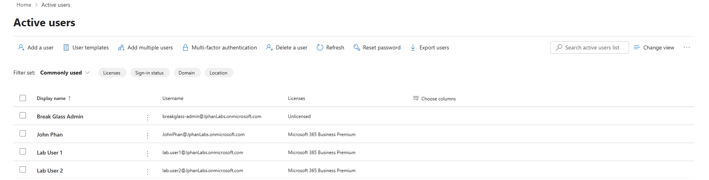
*Both test users licensed for Business Premium (includes Intune + Entra ID P1). The break-glass account is intentionally unlicensed.*

> License assignment has moved out of the Entra admin center. The user **Licenses** blade is now read-only, and assignments are made in the **Microsoft 365 admin center** (see [Issue #8](#issues--fixes)).

#### 1.2 – Break-glass account

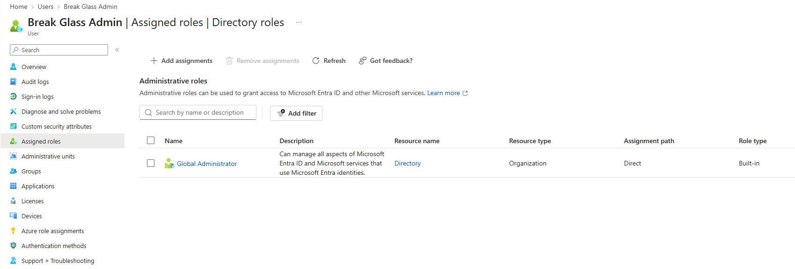
*Global Administrator assigned **directly** and **permanently active**, not through PIM. An emergency access account has to work even when PIM, MFA, or Conditional Access is broken. It uses a 20+ character password stored offline and will be excluded from every CA policy in Phase 9.*

#### 1.3 – Disable security defaults

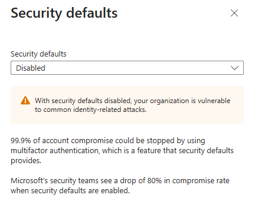
*Reason selected: "My organization is planning to use Conditional Access." The option to auto-create Microsoft's replacement CA policies was **unchecked**, so the only CA policy in the tenant is the one designed in Phase 9 (with the break-glass exclusion).*

> Security defaults and Conditional Access are mutually exclusive. Until Phase 9 the test users have no MFA requirement, which is acceptable in an isolated lab. The admin account has Microsoft Authenticator registered, and Microsoft separately enforces MFA for admin portals.

#### 1.4 – MDM user scope

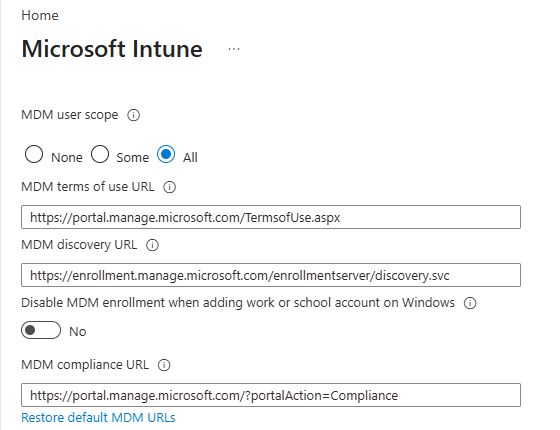
*MDM user scope **All**, and "Disable MDM enrollment when adding work or school account" left **No**. WIP (formerly MAM) user scope is **None**: Windows Information Protection is retired, and for Entra-joined devices MDM takes precedence anyway.*

> If a user isn't in the MDM user scope, Autopilot fails at enrollment with error **80180018**. This setting was found reverted to **None** during a later check and corrected before any deployment (see [Issue #11](#issues--fixes)).

#### 1.5 – Device join settings and LAPS

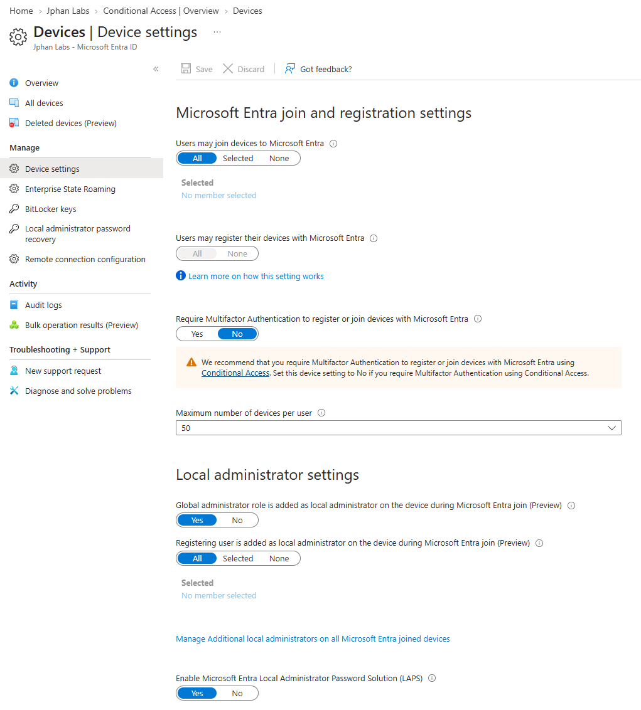
*Users may join devices: **All**. LAPS: **Yes**. "Require MFA to join" is left **No** because MFA will be enforced through Conditional Access instead.*

> This toggle is the tenant-level switch for Windows LAPS. Without it, the Intune LAPS policy in Phase 6 applies but passwords are never backed up to Entra ID.
>
> "Registering user is added as local administrator" shows **All**, but the Autopilot profile in Phase 4 sets **User account type: Standard**, which overrides it for Autopilot devices.

#### 1.6 – Company branding

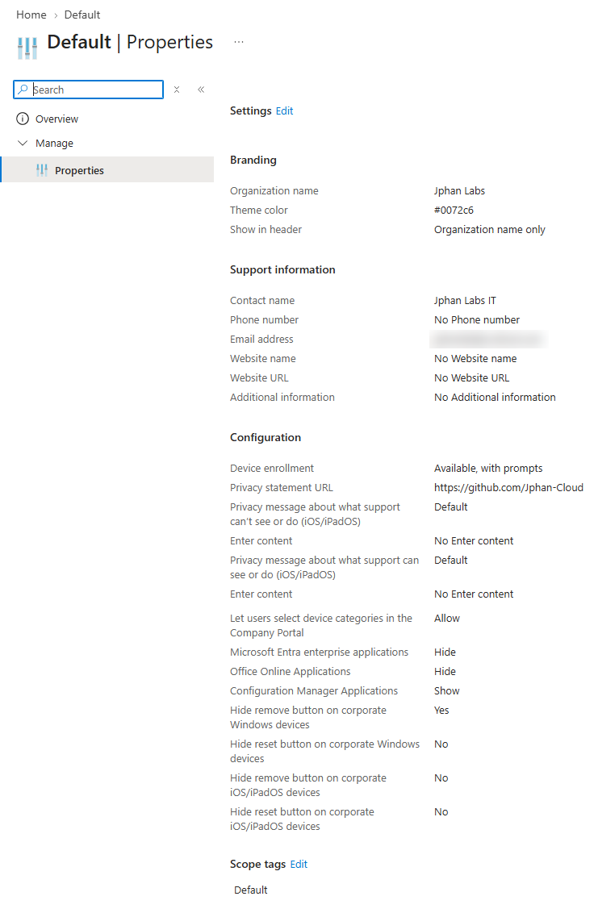
*Default customization policy: organization name, IT support contact, and privacy statement URL (required). Customization policies can target **user** groups only, never device groups.*

### Phase 2 – Dynamic Device Group ✅

Create a group that automatically contains every Autopilot-registered device.

- **Entra → Groups → New group**
- Type: Security · Membership: **Dynamic Device**
- Name: `SG-Autopilot-Devices`
- Rule:

```text
(device.devicePhysicalIDs -any (_ -contains "[ZTDId]"))
```

> `ZTDId` is the tag Autopilot stamps on every registered device. Any device imported into Autopilot joins this group automatically, so all profiles and policies target it without manual assignment.

> The rule builder can display this rule (Property `devicePhysicalIds`, Operator `Any`), but the value is an expression, so it was pasted into the **Rule syntax** box.

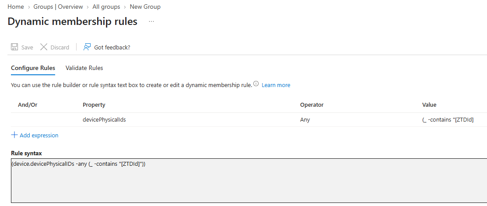
*Dynamic membership rule entered in the Rule syntax box; the builder parsed it as `devicePhysicalIds` / `Any`*

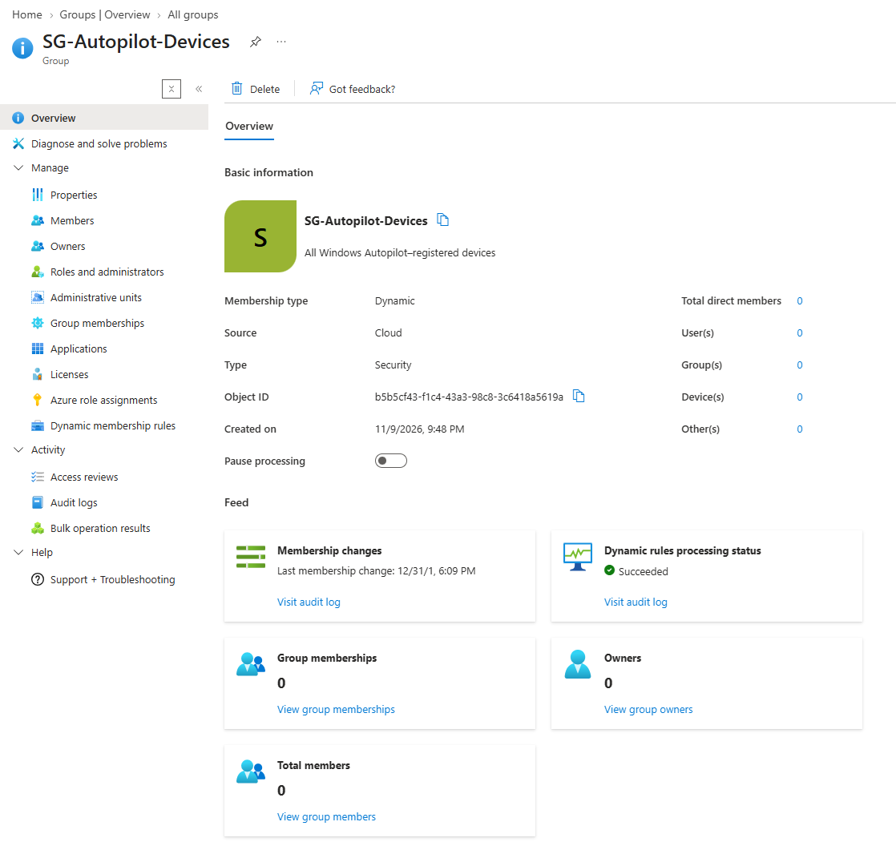
*Dynamic security group created with rule processing **Succeeded**. 0 members until devices are imported into Autopilot in 3c.*

> The group was created in the Entra admin center after resolving an AADSTS50020 sign-in error (see [Issue #12](#issues--fixes)).

### Phase 3 – Capture the Hardware Hash and Register in Autopilot

#### 3a – Capture the hash at OOBE (offline CSV) ✅

In production, the OEM or reseller registers devices. Here the hash was captured manually, which is the same method IT uses for existing devices or vendors that don't support Autopilot registration.

In each VM at the OOBE region screen, press **Shift + F10** to open a command prompt, then:

```powershell
powershell
Set-ExecutionPolicy -Scope Process -ExecutionPolicy Bypass -Force
New-Item -Type Directory -Path C:\HWID
Install-Script -Name Get-WindowsAutopilotInfo -Force
Get-WindowsAutopilotInfo -OutputFile C:\HWID\W11-LAB-02.csv
Get-ChildItem C:\HWID
```

#### 3b – Get the CSV out of the VM ✅

At OOBE there's no signed-in user, so there's no clipboard or file copy into the host. Instead, the VM was shut down and its disk was mounted **read-only** on the host:

```powershell
# On the Hyper-V host
Mount-VHD -Path "C:\Hyper-V\W11-LAB-02\W11-LAB-02.vhdx" -ReadOnly
Get-Volume                         # Windows partition mounted as D:
New-Item -Type Directory -Path C:\HWID -Force
Copy-Item D:\HWID\*.csv C:\HWID\
Dismount-VHD -Path "C:\Hyper-V\W11-LAB-02\W11-LAB-02.vhdx"
```

The same steps were repeated for `W11-LAB-01`. Both VMs were then rolled back to `Clean-OOBE`, which discards the capture changes and returns them to an untouched state for the Autopilot test.

| File | Size |
|------|------|
| `W11-LAB-01.csv` | 8,184 bytes |
| `W11-LAB-02.csv` | 8,184 bytes |

> Hardware hash CSVs are excluded from the repo by `.gitignore`, and serial numbers are blurred in all screenshots. Both uniquely identify a device.

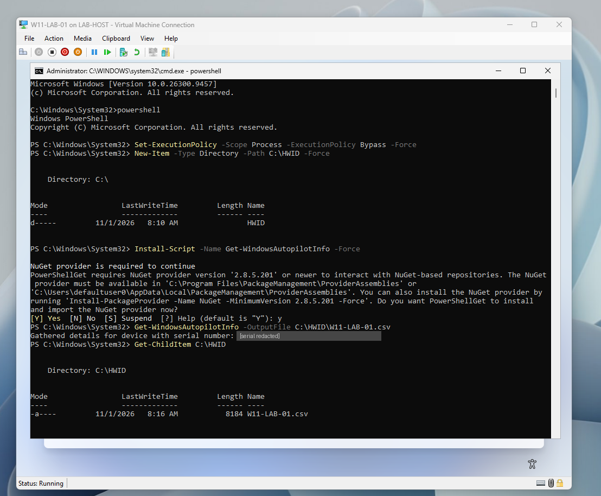
*W11-LAB-01: hash captured to CSV and verified (serial redacted)*

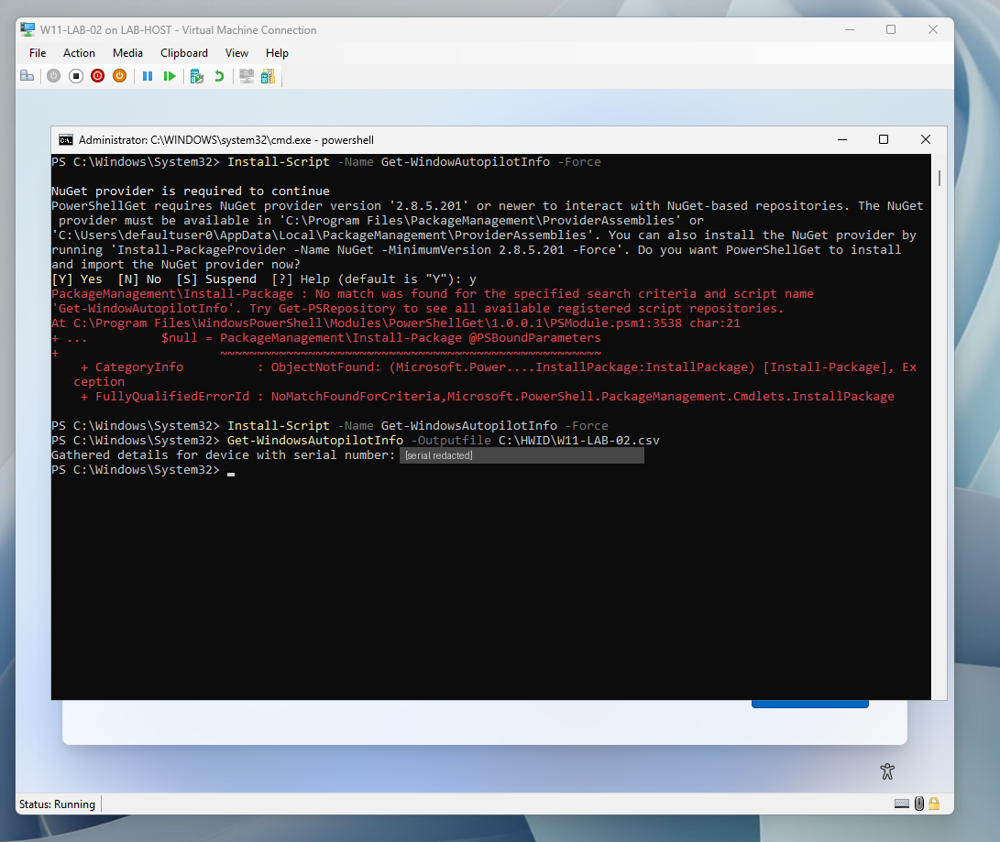
*W11-LAB-02: the `Get-WindowAutopilotInfo` typo from [Issue #4](#issues--fixes), then the corrected command (serial redacted)*

#### 3c – Import into Autopilot ✅

**Intune → Devices → Enrollment → Windows → Devices (Autopilot) → Import** → select the CSV. The devices should appear within ~15 minutes and join `SG-Autopilot-Devices` automatically.

> **Alternative:** `Get-WindowsAutopilotInfo -Online -GroupTag "LAB"` uploads the hash directly after an Intune admin sign-in, so no CSV is created.

> **Note:** Windows Autopilot *device preparation* is a newer option that skips hardware hash registration. This lab uses classic user-driven Autopilot because it remains heavily tested on MD-102 and is still the standard in most enterprises.

Each CSV was imported separately. Intune accepts one file per import and disables **Import** until the current one finishes (the banner allows up to 15 minutes; each took only a few).

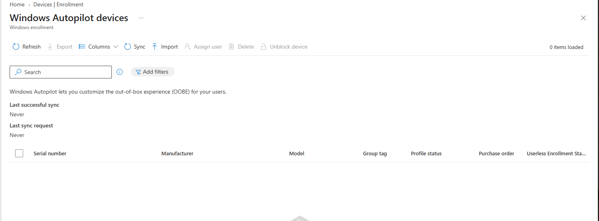
*Before: no Autopilot devices and the tenant has never synced*

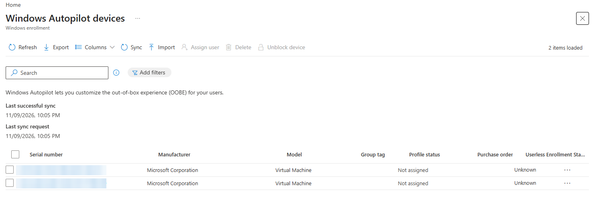
*After: both hashes imported. Hyper-V VMs report as Microsoft Corporation / Virtual Machine. Profile status is **Not assigned** until the deployment profile is created in Phase 4 (serials redacted).*

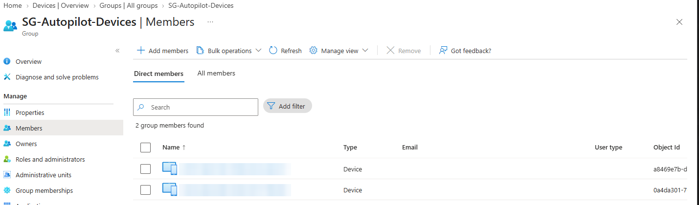
*Both devices joined the dynamic group automatically within minutes of import, confirming the `[ZTDId]` rule works. Device objects are named by serial until enrollment (serials redacted).*

### Phase 4 – Autopilot Deployment Profile ✅

**Intune → Devices → Enrollment → Windows → Deployment profiles → Create profile (Windows PC)**

| Setting | Value | Why |
|---------|-------|-----|
| Convert all targeted devices to Autopilot | No | Not needed for new devices |
| Deployment mode | User-driven | User signs in with their own account |
| Join to Entra ID as | Microsoft Entra joined | Cloud-only, no on-prem AD dependency |
| Microsoft Software License Terms | Hide | Fewer clicks for the user |
| Privacy settings | Hide | Defaults applied by policy |
| Hide change account options | Hide | Prevents personal-account setup |
| User account type | **Standard** | User does not get local admin |
| Apply device name template | Yes → `LAB_%SERIAL%` | Consistent naming (15-character max; `%SERIAL%` is truncated to fit) |
| Assignment | `SG-Autopilot-Devices` | |

> The profile name is `AP_UserDriven_EntraJoin`. The name field rejects hyphens (see [Issue #13](#issues--fixes)).

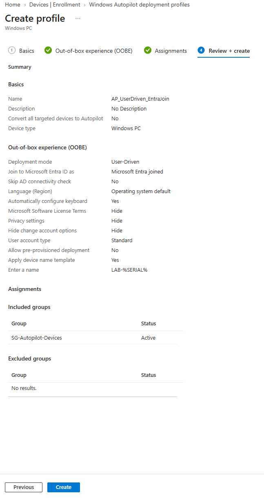
*Review + create summary: user-driven, Microsoft Entra joined, standard user account, OOBE screens hidden, assigned to `SG-Autopilot-Devices`.*

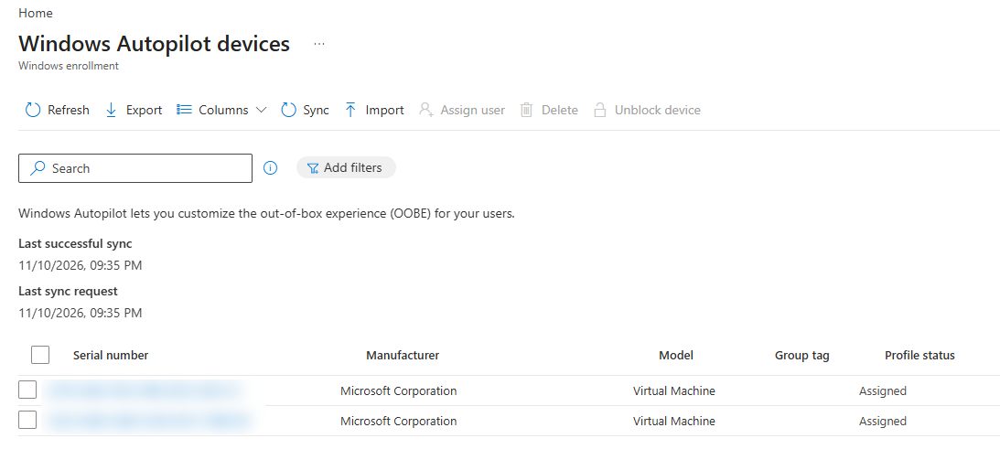
*After a Sync and a few refreshes, both devices changed from **Not assigned** to **Assigned**, confirming the dynamic group delivered the profile (serials redacted).*

### Phase 5 – Enrollment Status Page ✅

**Intune → Devices → Enrollment → Windows → Enrollment Status Page → Create**

Profile name: `ESP_Lab01` (the name field rejects hyphens, same as Issue #13).

| Setting | Value | Why |
|---------|-------|-----|
| Show app and profile configuration progress | Yes | User sees what is installing |
| Show an error when installation takes longer than | 60 minutes | Fails visibly instead of hanging |
| Show custom message on error | No | Default message is enough |
| Turn on log collection and diagnostics page | Yes | Lets users collect logs for troubleshooting |
| Only show page to devices provisioned by OOBE | Yes | ESP applies to Autopilot, not existing devices |
| Install Windows updates | **No** | Avoids long downloads and extra reboots in the lab |
| Block device use until all apps and profiles are installed | Yes | Device isn't usable until configured |
| Allow users to reset device on error | No | |
| Allow users to use device on error | **No** | If Yes, a failed install lets the user skip the ESP, which defeats the block setting |
| Block device use until required apps are installed | All | Switch to *Selected* after Phase 7 if only specific apps should block |
| Assignment | `SG-Autopilot-Devices` | |

> Windows updates was left on its default (Yes) at first and the "use device on error" toggle flipped to Yes while editing. Both were corrected before creating the profile. Block-until-installed only works when "allow use on error" is off.

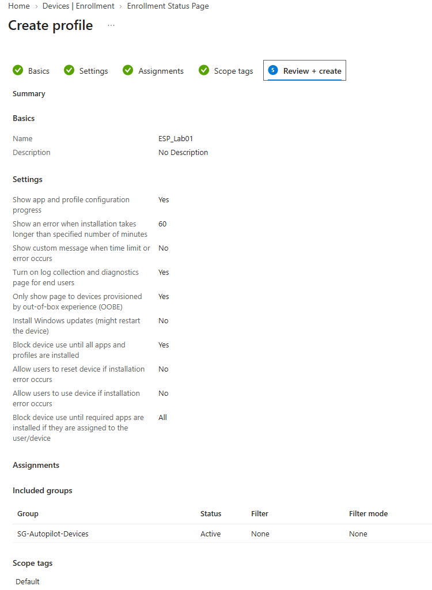
*Review + create summary: progress shown, 60-minute timeout, updates off, block device use on, use-on-error off, assigned to `SG-Autopilot-Devices`.*

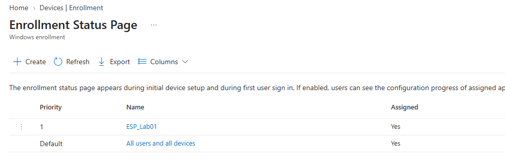
*`ESP_Lab01` is **Priority 1** and assigned, so it takes precedence over the **Default** profile (All users and all devices).*

### Phase 6 – Security Configuration ✅

Both policies are assigned to `SG-Autopilot-Devices`. Policy names use underscores because Intune name fields reject hyphens (see [Issue #13](#issues--fixes)).

#### 6.1 – BitLocker (`BitLocker_Lab01`)

**Endpoint security → Disk encryption → Create policy → Windows → BitLocker**

| Section | Setting | Value | Why |
|---------|---------|-------|-----|
| BitLocker | Require Device Encryption | Enabled | Turns encryption on |
| BitLocker | Allow Warning For Other Disk Encryption | Disabled | Required for silent encryption |
| BitLocker | Allow Standard User Encryption | Enabled | Autopilot users are standard users |
| BitLocker | Configure Recovery Password Rotation | Refresh on for Entra ID-joined devices | New key after the old one is used |
| Drive Encryption | Cipher strength | Enabled, **XTS-AES 256-bit** for OS and fixed drives | Stronger cipher; removable left at AES-CBC 128-bit default |
| OS Drives | Require additional authentication at startup | Enabled | Lets TPM-only protection run silently |
| OS Drives | Allow BitLocker without a compatible TPM | **False** | Prevents a password or USB-key prompt |
| OS Drives | TPM startup | Allow TPM | |
| OS Drives | TPM startup key / PIN / key and PIN | **Do not allow** (all three) | No user interaction at startup |
| OS Drives | Recovery options | Enabled | |
| OS Drives | Allow data recovery agent | False | Legacy domain method, not used |
| OS Drives | 48-digit recovery password / 256-bit recovery key | Allow / Do not allow | |
| OS Drives | Omit recovery options from the setup wizard | True | User is never asked to save a key |
| OS Drives | Save recovery information to AD DS (Entra ID) | True | Key is escrowed to Entra ID on Entra-joined devices |
| OS Drives | Do not enable BitLocker until recovery information is stored | **True** | No drive is encrypted without a backed-up key |
| Fixed and Removable Data Drives | All 5 settings | Not configured | The VMs have only an OS drive |

> The setting names still say "AD DS" because Microsoft kept the legacy Group Policy wording. On Entra-joined devices the same settings escrow the recovery key to Entra ID. Silent encryption needs three things together: **Allow Warning For Other Disk Encryption = Disabled**, **TPM-only startup** with every PIN and key option set to *Do not allow*, and **Allow Standard User Encryption = Enabled**.

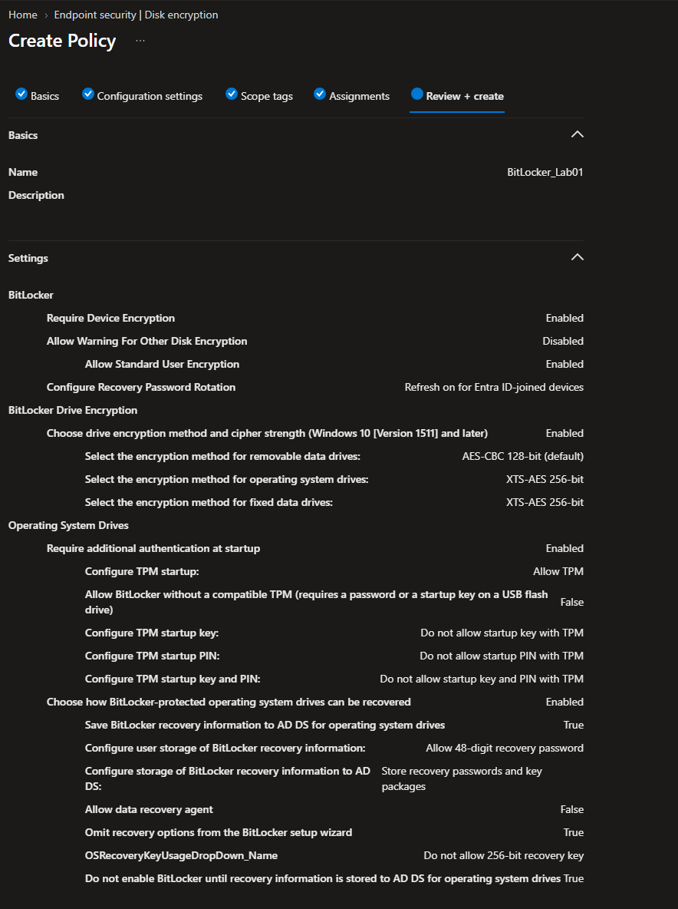
*Review + create: 22 settings, XTS-AES 256-bit, TPM-only startup, recovery key escrow required before encryption.*

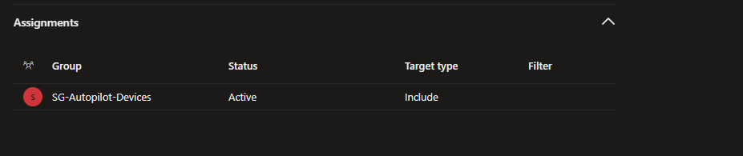
*Assigned to `SG-Autopilot-Devices` (Include, Active).*

#### 6.2 – Windows LAPS (`LAPS_Lab01`)

**Endpoint security → Account protection → Create policy → Windows → Local admin password solution (Windows LAPS)**

| Setting | Value | Why |
|---------|-------|-----|
| Backup Directory | Backup the password to Microsoft Entra ID only | Entra-joined, no on-prem AD |
| Password Age Days | 30 | Rotates monthly |
| Password Complexity | Large + small letters + numbers + special characters | |
| Post Authentication Actions | Reset the password and logoff the managed account | Password rotates after it has been used |
| Administrator Account Name, Password Length, Reset Delay, Automatic Account Management | Not configured | Defaults are fine for this lab |

> The tenant-level LAPS switch was turned on in Phase 1.5. Without it, this policy applies but passwords are never backed up to Entra ID.

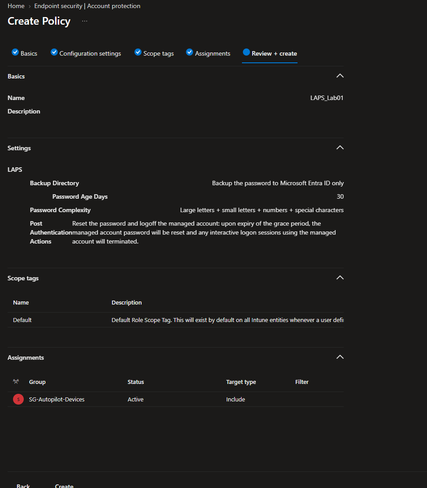
*Review + create: backup to Entra ID only, 30-day password age, full complexity, reset and log off after use, assigned to `SG-Autopilot-Devices`.*

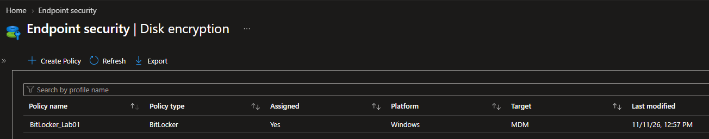
*`BitLocker_Lab01` created: Assigned **Yes**, platform Windows, target MDM.*

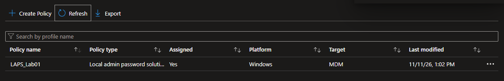
*`LAPS_Lab01` created: Assigned **Yes**, platform Windows, target MDM.*

### Phase 7 – Applications ✅

Two required apps, both assigned to `SG-Autopilot-Devices`: **Microsoft 365 Apps** (built-in Intune app type) and **Google Chrome Enterprise** (custom Win32 package, to demonstrate packaging and detection rules).

#### 7.1 – Microsoft 365 Apps

**Apps → Windows → Add → Microsoft 365 Apps (Windows 10 and later)**

| Setting | Value | Why |
|---------|-------|-----|
| Apps | Excel, Outlook, PowerPoint, Word | Teams removed to keep the ESP install short |
| Architecture | 64-bit | |
| Default file format | Office Open XML Format | Standard .docx / .xlsx / .pptx |
| Update channel | Current Channel | |
| Remove other versions | Yes | Clears any pre-installed Office |
| Version to install | Latest | |
| Shared computer activation | No | Single-user devices |
| Accept license terms on behalf of users | Yes | No prompt during Autopilot |
| Microsoft Search in Bing background service | No | Not needed |
| Assignment | Required → `SG-Autopilot-Devices` | |

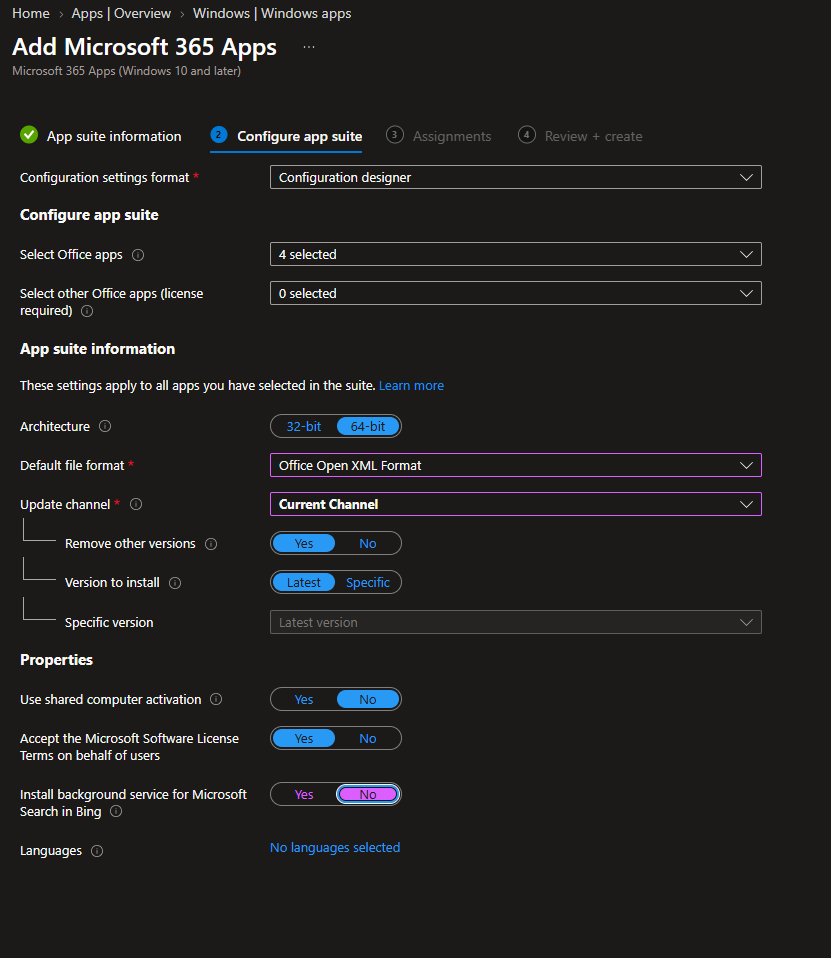
*App suite settings: four apps, 64-bit, Current Channel, license accepted on behalf of users.*

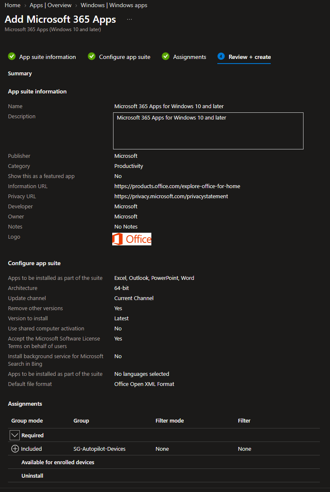
*Review + create: **Required → Included → SG-Autopilot-Devices**.*

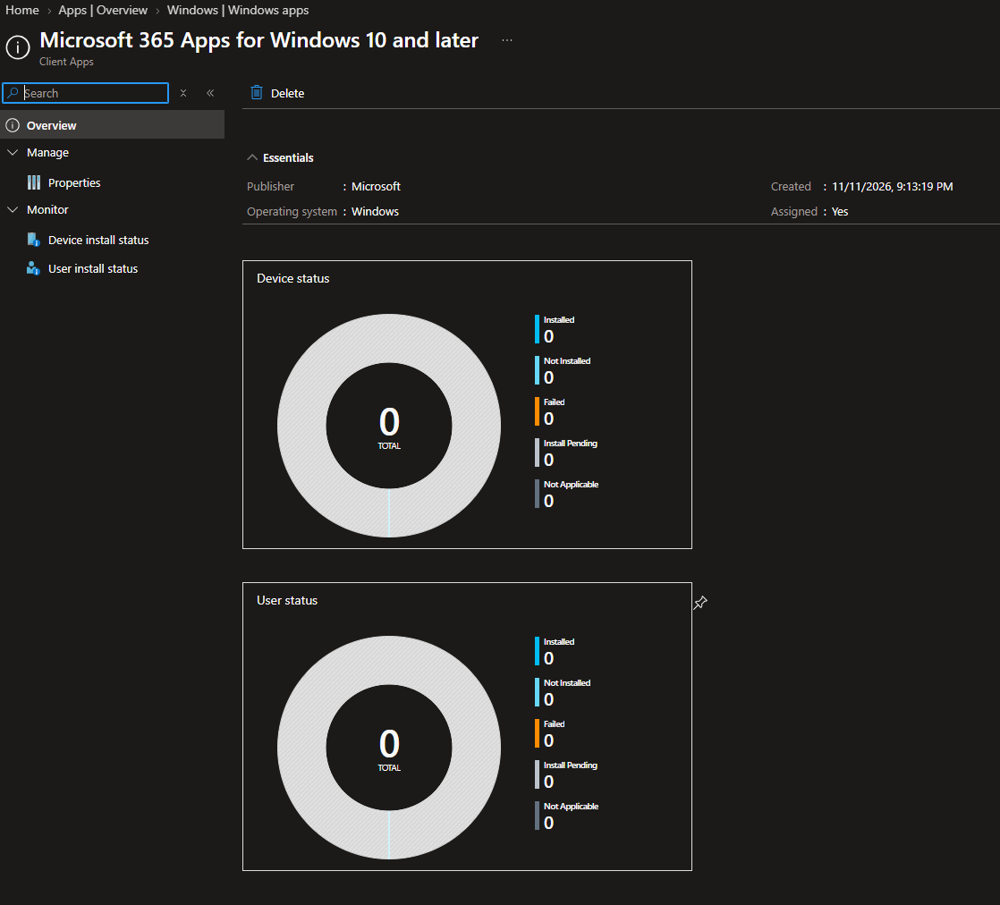
*App created and assigned. Device and user counts are 0 until a device enrolls.*

#### 7.2 – Google Chrome Enterprise as a Win32 app

The Chrome Enterprise MSI was downloaded from Google and packaged on the admin PC with the Microsoft Win32 Content Prep Tool:

```powershell
# Package the MSI with the Microsoft Win32 Content Prep Tool
.\IntuneWinAppUtil.exe -c .\source -s googlechromestandaloneenterprise64.msi -o .\output
```

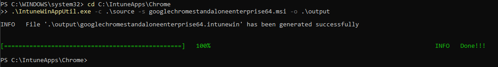
*Packaging output, cropped to remove local user paths. The result is a ~164 MB `.intunewin` file.*

**Apps → Windows → Add → Windows app (Win32)** → upload the `.intunewin` file.

| Tab | Setting | Value |
|-----|---------|-------|
| App information | Name / Publisher / Version | Google Chrome / Google / 157.0.8103.79 (read from the MSI) |
| Program | Install command | `msiexec /i "googlechromestandaloneenterprise64.msi" /qn` |
| Program | Uninstall command | `msiexec /x "{B3DB5E18-7FDA-3432-9931-2E60D41BD242}" /qn` (product code filled in by Intune) |
| Program | Install behavior | System (set by the per-machine MSI) |
| Program | Device restart behavior | **No specific action** (default was "may force a restart") |
| Requirements | Architecture / minimum OS | x64 only / Windows 10 21H2 |
| Detection rules | Rule type | MSI product code (added automatically) |
| Assignments | Required | `SG-Autopilot-Devices` |

> A forced restart in the middle of the Enrollment Status Page could break the Autopilot run, so restart behavior was changed from the default. Install behavior is greyed out because Intune sets it from the MSI, and the Chrome Enterprise MSI installs per machine, which is the **System** context Autopilot needs.

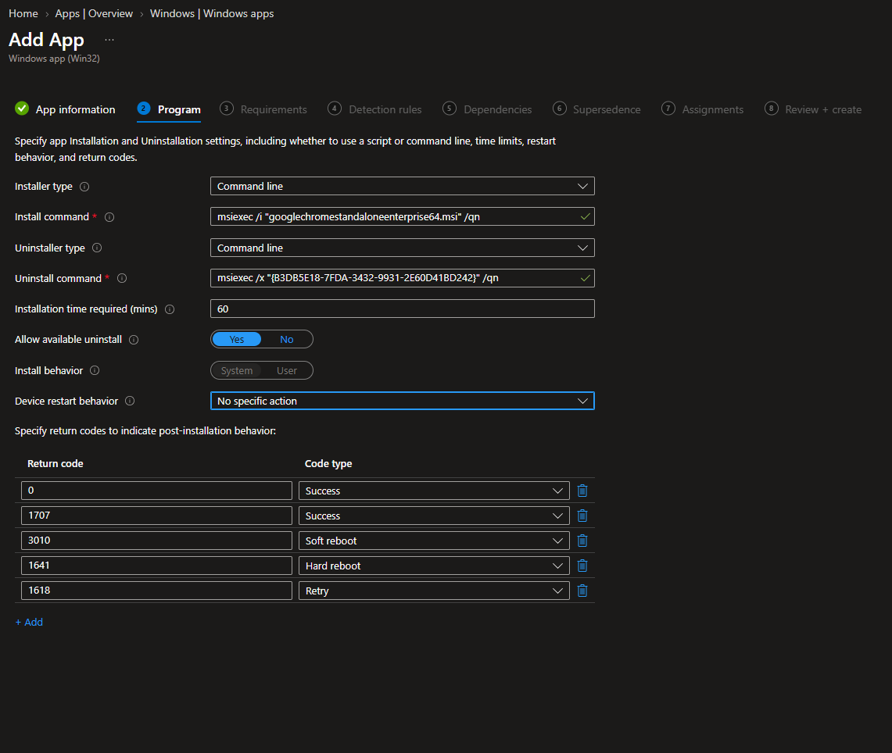
*Install and uninstall commands, System context, no forced restart.*

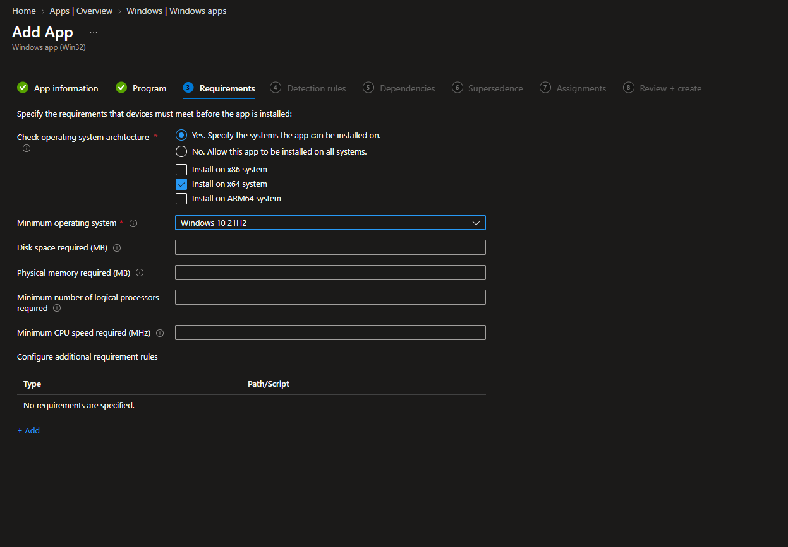
*x64 only, Windows 10 21H2 minimum.*

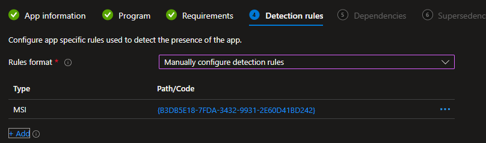
*MSI detection rule. The product code matches the uninstall command.*

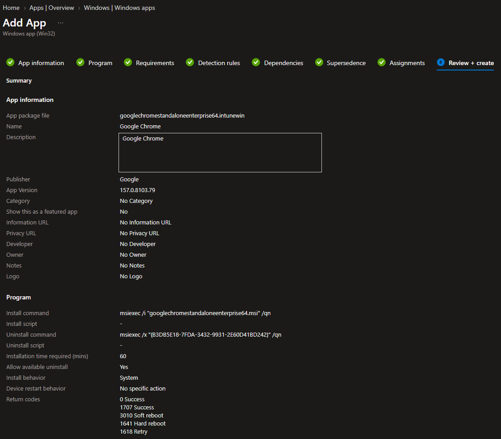
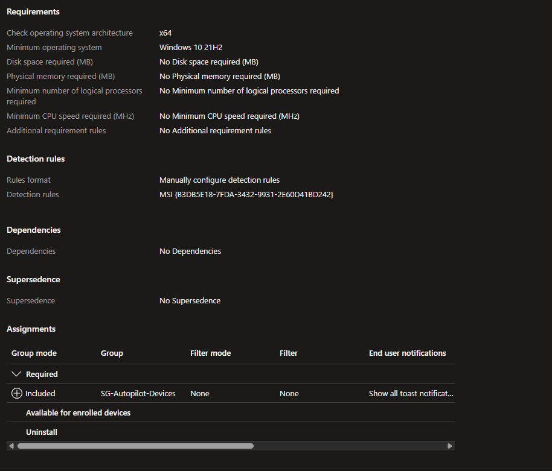
*Review + create: no dependencies or supersedence, **Required → Included → SG-Autopilot-Devices**.*

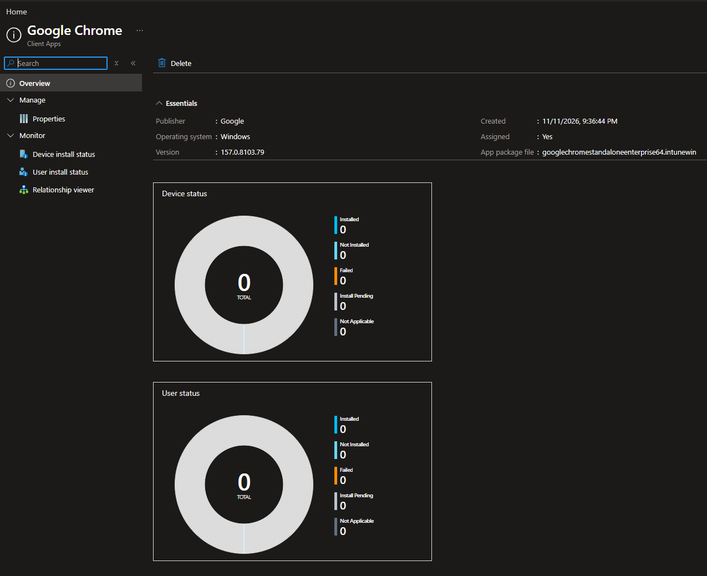
*App created and assigned.*

> `.intunewin` output files are excluded from the repo by `.gitignore`.

### Phase 8 – Compliance Policy

**Devices → Compliance → Create policy → Windows 10 and later**

| Category | Setting | Value |
|----------|---------|-------|
| Device Health | Require BitLocker | Require |
| Device Health | Require Secure Boot | Require |
| Device Properties | Minimum OS version | Current supported build |
| System Security | Firewall | Require |
| System Security | Microsoft Defender Antimalware | Require |
| System Security | Real-time protection | Require |
| Actions | Mark device noncompliant | Immediately (0 days) |

Assign to `SG-Autopilot-Devices`.

### Phase 9 – Conditional Access

**Entra → Protection → Conditional Access → New policy**

| Setting | Value |
|---------|-------|
| Name | `CA01 - Require compliant device for M365` |
| Users | Include: test users group · **Exclude: break-glass account** |
| Target resources | Office 365 |
| Conditions → Device platforms | Windows |
| Grant | **Require device to be marked as compliant** |
| Enable policy | **Report-only** first, then **On** after verification |

> Starting in Report-only confirms the impact in sign-in logs before enforcing, the same change-management approach used in production.

📸 *Screenshot: CA policy summary*

---

## Deployment & Verification

1. In Hyper-V, apply the `Clean-OOBE` checkpoint to the VM so it boots like a brand-new device
2. Start the VM, connect to the network, and sign in as `lab.user1`
3. Watch the company branding and ESP progress screens

| Check | How | Expected result |
|-------|-----|-----------------|
| Entra join | `dsregcmd /status` | `AzureAdJoined : YES` |
| Intune enrollment | Intune → Devices → Windows | Device listed as `LAB-<serial>`, user `lab.user1` |
| Device name | Settings → System → About | Matches template |
| Standard user | `net localgroup administrators` | `lab.user1` **not** listed |
| Apps | Start menu | Microsoft 365 Apps + Google Chrome installed |
| BitLocker | `manage-bde -status C:` | Protection On, XTS-AES |
| Recovery key escrow | Intune → device → Recovery keys | Key present |
| LAPS | Intune → device → Local admin password | Password retrievable, rotation date shown |
| Compliance | Intune → device → Device compliance | **Compliant** |
| CA (Report-only) | Entra → Sign-in logs → Report-only tab | "Report-only: Success" |

A verification script that checks most of these from the device is in [`../../practice/Test-DeviceReadiness.ps1`](../../practice/Test-DeviceReadiness.ps1).

### Proving Conditional Access Works

1. Switch the CA policy from Report-only to **On**
2. Temporarily edit the compliance policy so the **minimum OS version** is higher than the device's build
3. Sync the device (Settings → Accounts → Access work or school → Info → Sync)
4. Device shows **Not compliant**, and opening Outlook or office.com is **blocked** with a "device must be compliant" message
5. Revert the minimum OS version, sync again, and access is restored

📸 *Screenshots: noncompliant status, CA block page, sign-in log showing "Failure" with policy CA01*

---

## Issues & Fixes

| # | Symptom | Root cause | Fix |
|---|---------|-----------|-----|
| 1 | VM showed UEFI boot summary: "The boot loader failed" | Missed the *"Press any key to boot from CD or DVD"* prompt, so the VM skipped the ISO and tried to boot from an empty disk | Restarted the VM and pressed a key at the prompt |
| 2 | Hash-capture commands ran but weren't in the VM | Typed the first commands into a PowerShell window on the **host**, not the VM console | Re-ran them inside the VM's Shift+F10 prompt. Lesson: always confirm which machine a console belongs to before running commands |
| 3 | Prompted to install the NuGet provider and trust PSGallery | Fresh Windows install has no NuGet provider, and `Install-Script` needs it to download from the PowerShell Gallery | Answered **Y** to both prompts (`-Force` suppresses them on reruns) |
| 4 | `No match was found for the specified search criteria` | Typo: `Get-WindowAutopilotInfo` (missing the "s") | Corrected to `Get-WindowsAutopilotInfo` |
| 5 | No way to copy the CSV from the VM to the host | At OOBE there's no signed-in user, so Hyper-V enhanced session (clipboard/file copy) isn't available | Shut down the VM, mounted its VHDX **read-only** on the host with `Mount-VHD`, copied the CSV, then dismounted |
| 6 | `'Test-Path' is not recognized` when verifying the rollback | Shift+F10 opens **cmd**, and `Test-Path` is a PowerShell cmdlet | Ran `dir C:\HWID` in cmd (*File Not Found* = rollback confirmed), or typed `powershell` first |
| 7 | `Get-VM : You do not have the required permission to complete this task` | PowerShell on the host wasn't elevated (prompt opened in `C:\Users\<user>`, not `C:\WINDOWS\system32`) | Reopened PowerShell with **Run as administrator**. Hyper-V cmdlets need admin rights or membership in the Hyper-V Administrators group |
| 8 | Entra user **Licenses** blade showed "No license assignments found" with no way to add one | Microsoft moved license assignment to the Microsoft 365 admin center; the Entra blade is now view-only | Assigned licenses from **M365 admin center → Billing → Licenses → Assign licenses** |
| 9 | After a two-user license assignment, `lab.user2` still showed **Unlicensed** | Bulk assignment hadn't finished processing for the second user | Refreshed and verified in **Active users**. Lesson: confirm every account after a bulk change, not just the first one |
| 10 | Company branding values didn't appear after editing | Clicked **Review + save** but left before clicking **Save** on the review page | Re-entered the values and completed both steps. The **Privacy statement URL** field is also required before saving |
| 11 | During a screenshot recheck, Automatic Enrollment showed **MDM user scope: None** | The original change to *All* was never saved (Save button state wasn't confirmed) | Set *All*, saved, reloaded the page to confirm it stuck. Caught before Phase 4, where it would have caused enrollment error 80180018. Lesson: after saving a portal setting, reload and verify |
| 12 | `AADSTS50020` when opening the Entra admin center: first for a personal `live.com` account, then for the tenant admin against tenant **"Microsoft Services"** | The browser reused a cached personal Microsoft account session, which routes to Microsoft's "Microsoft Services" tenant. Switching accounts mid-flow kept that tenant (the same Correlation ID appeared on both errors). Intune still worked because it started a fresh sign-in | Opened the tenant-specific URL `entra.microsoft.com/JphanLabs.onmicrosoft.com`, which forces the correct tenant, and bookmarked it. Lesson: keep lab admin sessions in a separate browser profile |
| 13 | Creating the Autopilot deployment profile failed validation with **Character "-" is not allowed** on the Name field | The profile name field rejects hyphens | Renamed the profile from `AP-UserDriven-EntraJoin` to `AP_UserDriven_EntraJoin`. Lesson: when a portal rejects a name, check the character rules before retrying |

<details>
<summary>Common issues reference</summary>

| Symptom | Likely cause |
|---------|-------------|
| Device doesn't get Autopilot profile at OOBE | Profile not yet assigned (check "Profile status" on the Autopilot device); dynamic group membership still processing |
| "Something went wrong" / 80180018 during enrollment | User not licensed for Intune, or MDM user scope doesn't include the user |
| ESP stuck on apps | Win32 detection rule wrong, so Intune keeps thinking install failed |
| BitLocker not encrypting silently | "Allow warning for other disk encryption" not disabled, or no TPM |
| CA policy can't be created | Security defaults still enabled |
| Device noncompliant right after enrollment | Compliance not yet evaluated; sync and wait before testing |

</details>

---

## Cleanup

- Delete the device from **Intune → Devices**, then from **Autopilot devices** (Intune record must go first)
- Delete the Entra device object
- Set CA policy to **Off** or delete it
- Remove test users or let the trial expire
- Apply `Clean-OOBE` to the VMs, or delete them

---

## Skills Demonstrated

- Hyper-V VM provisioning via GUI and PowerShell, with checkpoints for repeatable testing
- Windows Autopilot hardware hash capture (offline CSV) and user-driven deployment
- Intune enrollment, dynamic groups, and policy targeting
- Win32 app packaging and detection rules
- Endpoint security: BitLocker, Windows LAPS, compliance policies
- Conditional Access design with break-glass exclusion and report-only rollout
- Verification and troubleshooting with `dsregcmd`, `manage-bde`, and Intune diagnostics
