# Lab 02 – Update Management with Intune Update Rings

  

## Business Scenario

A company's IT team wants to roll out Windows quality updates (Patch Tuesday) and feature updates (version upgrades) in a controlled way instead of letting every device grab them on day one. The pattern most enterprises follow:

1. A small **Pilot ring** gets every update immediately and acts as the canary
2. A larger **Broad ring** gets the same updates on a delay, so a bad patch that bricks Pilot never reaches the rest of the fleet
3. If something goes wrong in Pilot, the Broad ring is **paused** before its deferral expires

This lab builds that two-ring pattern in Intune and uses the two Autopilot VMs from Lab 01 as the ring members.

---

## Architecture

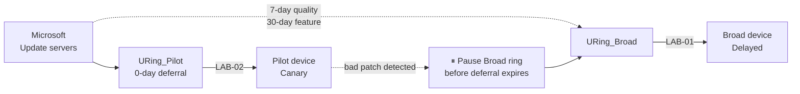

| Component | Role in this lab |
|-----------|------------------|
| Windows Autopilot | Re-deploys `W11-LAB-02` from the Clean-OOBE checkpoint so it enrolls against the Lab 01 tenant |
| Microsoft Intune – Update rings | The policy object that carries quality/feature deferrals and user-experience settings |
| Entra ID – Security groups | `SG-Updates-Pilot` and `SG-Updates-Broad` hold the device objects each ring targets |
| Windows Update for Business | The in-OS engine that honors the deferral values pushed down by Intune |

---

## Environment

This lab reuses the Lab 01 tenant and VMs. Nothing new was provisioned at the tenant level.

| Item | Details |
|------|---------|
| Tenant | `JphanLabs.onmicrosoft.com` (Microsoft 365 Business Premium trial from Lab 01) |
| Devices | `W11-LAB-01` and `W11-LAB-02` from Lab 01, redeployed via Autopilot |
| Build after deployment | Windows 11 **Version 26H2, OS Build 26300.9457** on both VMs |
| Users | `lab.user1`, `lab.user2` (licensed Business Premium, from Lab 01) |
| Intune objects reused | `SG-Autopilot-Devices`, `AP_UserDriven_EntraJoin`, `ESP_Lab01`, `BitLocker_Lab01`, `LAPS_Lab01`, `Compliance_Lab01`, `Microsoft 365 Apps`, `Google Chrome Enterprise` |

> Lab 01's Conditional Access policy `CA01` is left in **Report-only** during this lab so an accidental noncompliance during update testing doesn't block sign-in.

---

## Build Steps

### Phase 0 – Redeploy W11-LAB-02 via Autopilot ✅

`W11-LAB-02` was rolled back to its `Clean-OOBE` checkpoint and booted. The device was already registered in Autopilot from Lab 01 Phase 3, so the OOBE flow recognized the profile and launched the Autopilot sign-in automatically.

| Step | Result |
|------|--------|
| Sign in as `lab.user2@JphanLabs.onmicrosoft.com` | Authenticated with MFA via Authenticator |
| Enrollment Status Page | All three stages (Device prep, Device setup, Account setup) completed |
| Required apps installed by ESP | Microsoft 365 Apps and Google Chrome Enterprise |
| Windows Hello for Business PIN setup | **Skipped** — PIN setup errored, same behavior seen in Lab 01. Not required for this lab. |
| Hyper-V console connection | **Basic Session** mode required (Enhanced Session Mode fails because Autopilot-provisioned users are not in the local Remote Desktop Users group) |

**Winver baseline**

```text
Windows 11 Version 26H2 (OS Build 26300.9457)
```

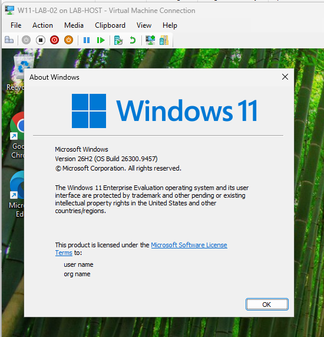
*Baseline Windows version after Autopilot. The identical build on both VMs makes any post-ring divergence attributable to ring policy.*

**Both devices visible and compliant in Intune**

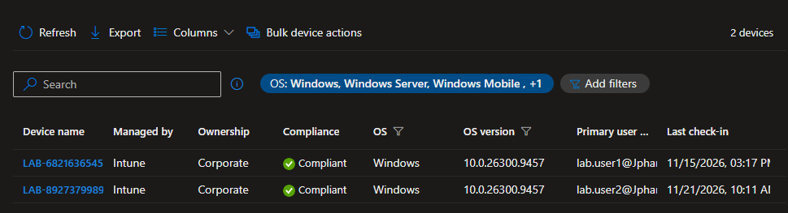
*`LAB-6821636545` (lab.user1, originally `W11-LAB-01`) and `LAB-8927379989` (lab.user2, redeployed `W11-LAB-02`). Both Intune-managed, Corporate, Compliant, on build 10.0.26300.9457. The portal truncates the trailing digit of each device name — the full names are `LAB-68216365451` and `LAB-89273799899` as shown in the Entra group member lists below.*

> **Hyper-V tip:** when connecting to a VM running an Entra-joined Autopilot session, flip **View → Enhanced Session off** or press `Ctrl + Alt + Break`. Enhanced Session Mode requires the signed-in user to be in the local Administrators or Remote Desktop Users group; Autopilot users start in neither. Basic Session loses clipboard sharing but works reliably.

### Phase 1 – Ring Groups ✅

Two Security groups with **Assigned** membership hold the ring members. Device-targeted groups are used (not user-targeted) so the update ring follows the hardware regardless of who signs in.

**Entra → Groups → New group**

| Group | Type | Membership | Member | Role |
|-------|------|------------|--------|------|
| `SG-Updates-Pilot` | Security | Assigned | `LAB-89273799899` (LAB-02) | Pilot / canary device |
| `SG-Updates-Broad` | Security | Assigned | `LAB-68216365451` (LAB-01) | Broad / delayed-ring device |

> **Why assigned and not dynamic?** With only two lab devices, explicit membership is simpler and more deterministic. Lab 01 already demonstrates a dynamic rule in `SG-Autopilot-Devices`, so using Assigned here covers the other half of the MD-102 group membership knowledge area.

> **Why device groups and not user groups?** Update rings targeted at device groups follow the hardware regardless of which user signs in, which matches how enterprises actually ring devices (IT pilot laptops vs. everyone else). Targeting a user group would mean the ring policy effectively follows the user to any device they touch.

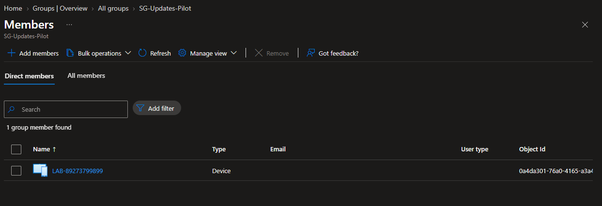
*`SG-Updates-Pilot`: Security / Assigned, 1 Device member, 0 Users. Description records the ring's purpose for future reference.*

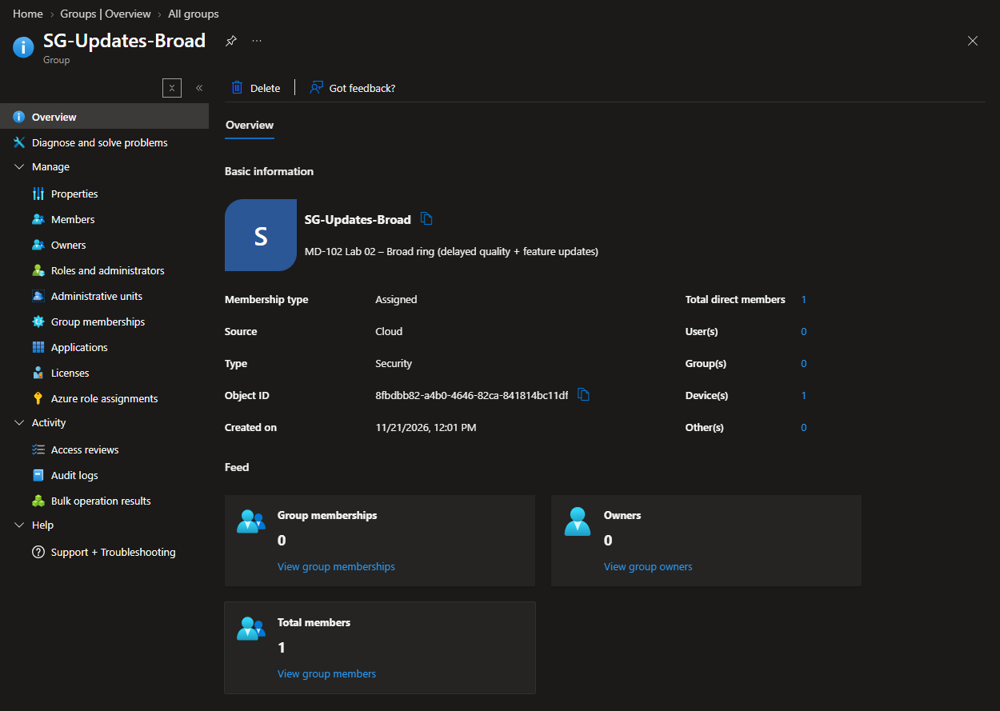
*`SG-Updates-Broad`: identical shape, holding `LAB-68216365451`.*

### Phase 2 – Update Rings ✅

**Intune → Devices → Manage updates → Windows updates → Update rings → Create profile**

Two update rings were created. Every setting is identical between them **except the two deferral values**, so any divergence in behavior between the rings is attributable only to the deferral timing — not to drift in any other setting.

| Setting | URing_Pilot | URing_Broad |
|---------|-------------|-------------|
| Microsoft product updates | Allow | Allow |
| Windows drivers | Allow | Allow |
| **Quality update deferral (days)** | **0** | **7** |
| **Feature update deferral (days)** | **0** | **30** |
| Upgrade Windows 10 to Windows 11 | No | No |
| Feature update uninstall period | 10 | 10 |
| Enable pre-release builds | Not Configured | Not Configured |
| Servicing channel | General Availability | General Availability |
| Automatic update behavior | Auto install at maintenance time | Auto install at maintenance time |
| Active hours start / end | 8 AM / 5 PM | 8 AM / 5 PM |
| Option to pause Windows updates | Disable | Disable |
| Option to check for Windows updates | Enable | Enable |
| Change notification update level | Default | Default |
| Use deadline settings | Allow | Allow |
| Deadline for feature updates / quality updates | 2 / 2 | 2 / 2 |
| Grace period | 1 | 1 |
| Auto reboot before deadline | Yes | Yes |
| Assigned group | `SG-Updates-Pilot` | `SG-Updates-Broad` |

> **Quality vs feature updates (MD-102 vocabulary):** Quality updates are the monthly Patch Tuesday security/reliability updates. Feature updates are major Windows version upgrades (e.g. 25H2 → 26H2). Enterprises typically defer quality updates by days-to-weeks and feature updates by weeks-to-months.

> **Deadline settings walkthrough:** when a quality update arrives on a device in either ring, the user has **2 days** to reboot on their own. After the deadline, a **1-day grace period** begins. If the user still hasn't rebooted, Windows forces the restart. Because *Auto reboot before deadline* is **Yes**, Windows attempts the restart during non-active hours before the deadline hits, so the forced reboot at the deadline only affects stubborn devices.

> **Pause behavior:** `Option to pause Windows updates: Disable` prevents end users from self-pausing updates via the Windows Update settings page. Admin-controlled rings only.

#### URing_Pilot

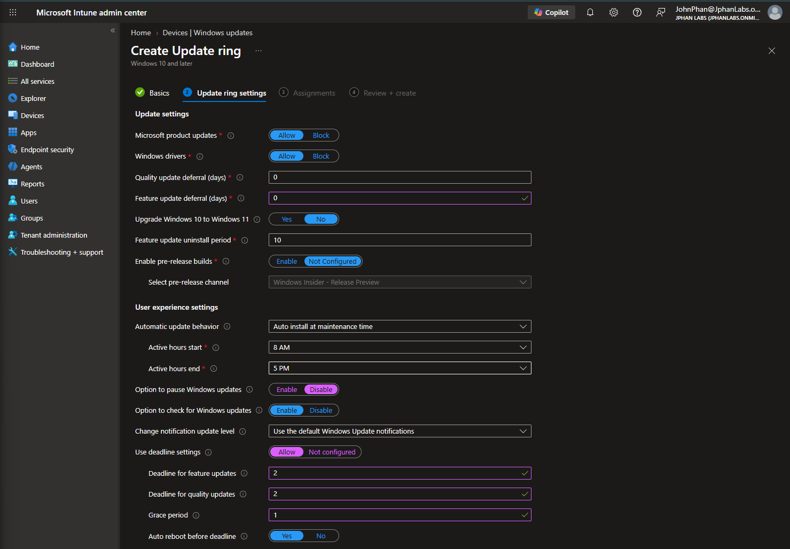
*All update settings and user experience settings for `URing_Pilot`. 0/0 deferrals, Microsoft products and drivers allowed, 8-5 active hours, 2/2/1 deadline with auto reboot before deadline.*

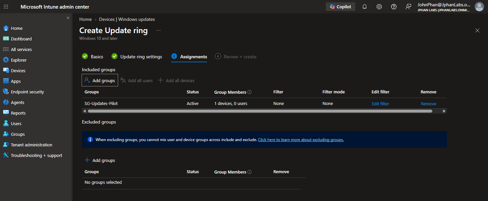
*Included group `SG-Updates-Pilot` — Active, 1 device, 0 users. No excluded groups, no filter.*

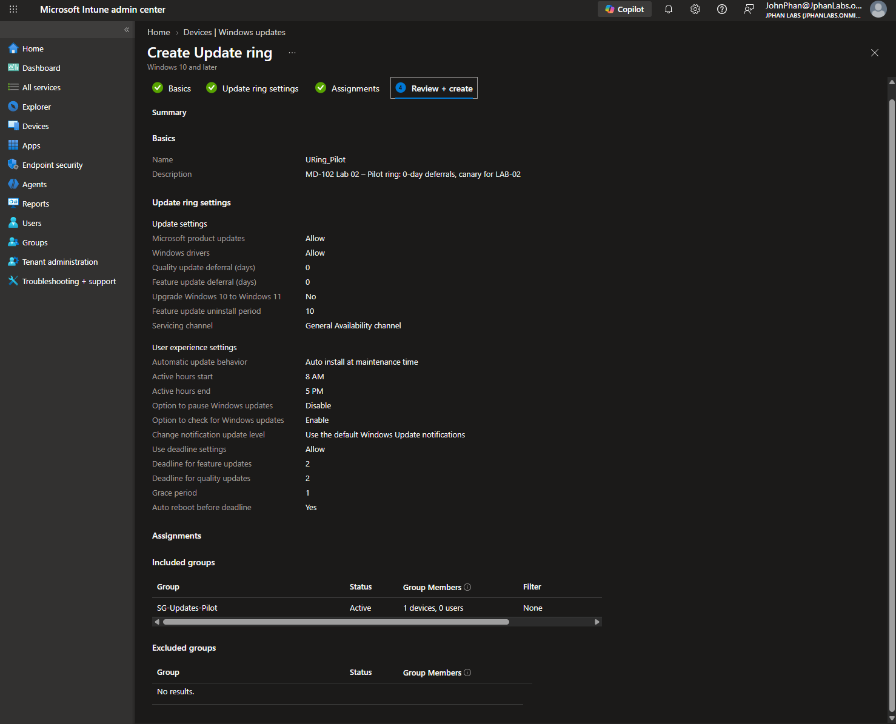
*Review summary before creation. The **Servicing channel: General Availability channel** line only appears here, not on the settings page — it is the correct default for production rings.*

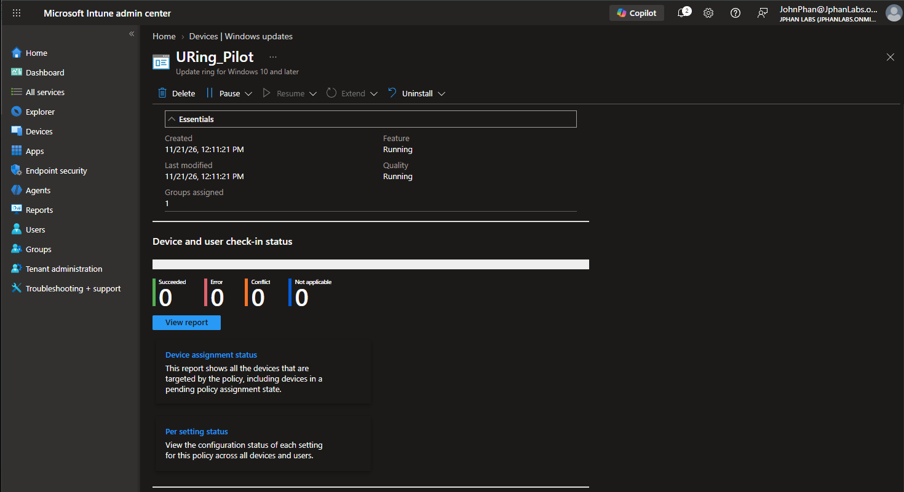
*Ring in a Running state for both Quality and Feature pipelines. The device check-in count shows 0/0/0/0 immediately after creation; counts populate once the device syncs. The toolbar `Pause ▼ / Resume ▼ / Extend ▼ / Uninstall ▼` controls are the per-ring ops used in production triage.*

#### URing_Broad

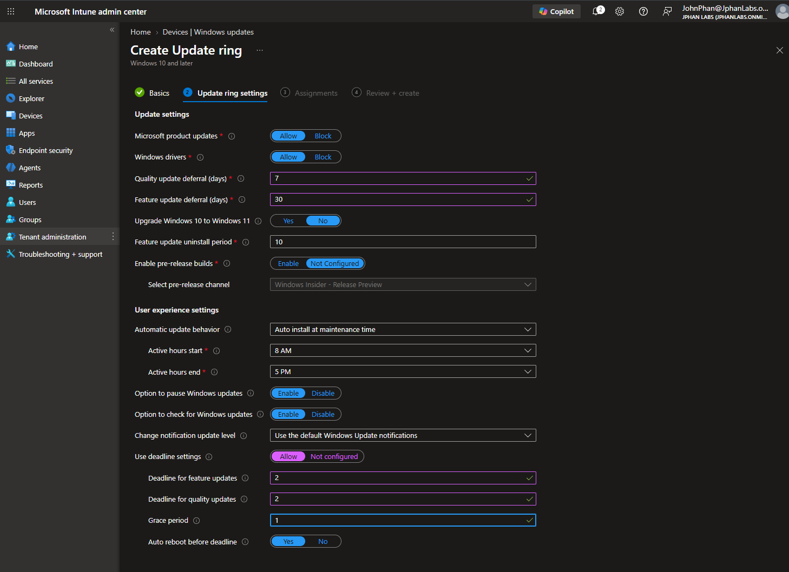
*Same page, same template, only the two deferral values differ: Quality = 7 days, Feature = 30 days. Every other setting matches Pilot exactly.*

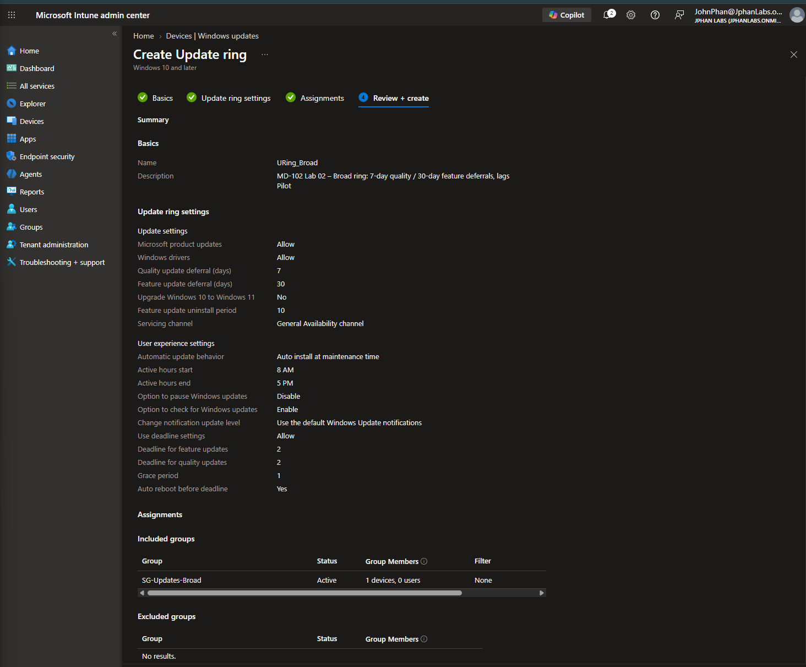
*Review summary after the pause-option fix (see Issues below). Included group `SG-Updates-Broad`, 1 device, 0 users.*

#### Both rings — the hero shot

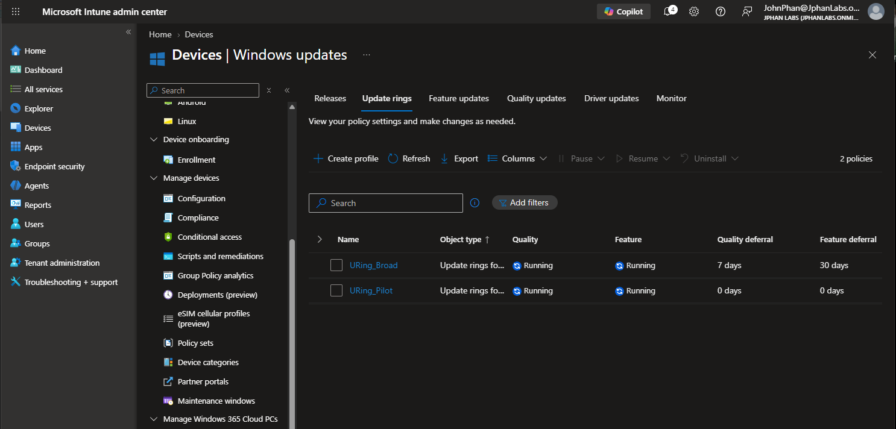
*`Devices → Windows updates → Update rings`. Both rings in **Running** state for Quality and Feature pipelines. The deferral columns (Quality deferral 0d/7d, Feature deferral 0d/30d) are the only differences — the matched-pair design means any divergence seen on the devices in Phase 4 is attributable to the ring policy.*

---

## Issues & Fixes

### #1 — Enhanced Session Mode fails for the Autopilot user

**Symptom:** vmconnect to `W11-LAB-02` after Autopilot sign-in displayed a Remote Desktop Services error screen for `Lab User 2` and never reached the desktop.

**Cause:** Hyper-V Enhanced Session Mode uses RDP over the VMBus. The signed-in guest user must be in the local **Administrators** or **Remote Desktop Users** group. Autopilot-provisioned Entra users start in neither (Lab 01 confirmed `lab.user1` is also not a local admin), so RDP is refused.

**Fix:** `View → Enhanced Session` (uncheck) or `Ctrl + Alt + Break` to toggle Basic Session. Basic Session connects to the VM's framebuffer directly, same as a physical monitor.

**Tradeoff:** Basic Session loses clipboard sharing and shared drives between host and VM. Clipboard can still be sent one-way via `Clipboard → Type clipboard text` in the menu bar.

### #2 — "Option to pause Windows updates" caught as Enable on the Broad ring Review page

**Symptom:** Broad ring Review + create page summarized `Option to pause Windows updates: Enable`, but Pilot had been created with `Disable`. The toggle pill in dark mode made it hard to see which side was active on the settings page itself.

**Cause:** The setting was left at its default (Enable) because the settings page toggle didn't visually commit when clicked.

**Fix:** Clicked **Previous** back to the Update ring settings tab, explicitly clicked **Disable**, returned to Review + create, confirmed the value now showed **Disable**, then created.

**Lesson:** Toggle pills in the Intune admin center don't always provide strong visual feedback for the currently selected side. The Review + create summary is the source of truth — always scan it before committing.

---

## Verification tasks still to do (Phase 4)

These are planned for a later session once Microsoft publishes a quality or feature update that both devices can pick up:

- [ ] Force a sync on LAB-02 and confirm the ring policy registers in `Settings → Windows Update → Advanced options` (pause control disabled, deferral values reflected)
- [ ] Confirm `UsoClient StartScan` / `wuauclt /detectnow` trigger the ring policy on both VMs
- [ ] When the next quality update arrives: verify LAB-02 receives it first, LAB-01 lags by 7 days
- [ ] Exercise the **Pause ▼** control on URing_Broad and confirm the device honors the pause
- [ ] Decide on the Phase 3 feature update policy approach (see below)

## Next up — Phase 3 (planned)

**Feature update policy** at `Devices → Windows updates → Feature updates`.

At the time of this writeup, Windows 11 **26H2** is already the current latest feature release, which complicates a straightforward "pilot gets 26H2 first, broad gets it later" demo because there's no newer version to move to. Three options under consideration:

1. **Pin both rings to 26H2** — demonstrates the policy mechanics but no observable device change
2. **Pin LAB-02 (Pilot) to 25H2** — tests the "hold a device back" scenario and intentionally produces the *Device beyond target version* state, which is itself an exam-relevant edge case
3. **Skip the feature update policy** — focus the lab on quality update rings only

Leaning toward option 2 for exam coverage of the "hold back" scenario.

---

## Why these settings matter (MD-102 exam angles)

- **Deferral values** are the single most tested concept in the update management domain — remember quality 0-30 days typical, feature 0-365 days typical
- **Device-group vs user-group assignment** — device-group is the canonical answer for update rings; user-group is correct when the use case is "this user's devices must defer updates"
- **Pause/Resume ↓** splits into Quality and Feature pipelines independently — the exam often tests this split
- **Pre-release builds / Servicing channel** — General Availability is default; Windows Insider channels are only for Insider testing and should not be the answer for production ring questions
- **Active hours + Deadline settings** — Microsoft's recommended approach for balancing patch compliance with user disruption; `Auto reboot before deadline: Yes` is the modern default
- **Enrollment Status Page did not require reconfiguration** — a policy-in-depth point: the ESP from Lab 01 continues to work for LAB-02's redeployment because it is assigned to `SG-Autopilot-Devices`, which is dynamic. New ring policies do not interfere with enrollment policies.
